# langx.io rankings, 2026-10-03 to 2026-10-09

Google Search Console, web search, property `sc-domain:langx.io`. Compared with 2026-09-26 to 2026-10-02. Position is the average rank when the page was shown; ↑ means it moved up. Queries with fewer than 20 impressions in either week are left out of the movers, since one search can swing them by whole places. Google hides rare queries, so a tracked keyword can be missing even when the page ranks for it.

## Totals

|  | This week | Week before |
| --- | --- | --- |
| Clicks | 139 | 134 |
| Impressions | 11,513 | 11,776 |
| CTR | 1.2% | 1.1% |
| Average position | 7.3 | 7.3 |

## Trends

The last 12 weeks, 2026-07-18 to 2026-10-09. Each point is the seven days ending on the date shown; the last one is this report’s week.

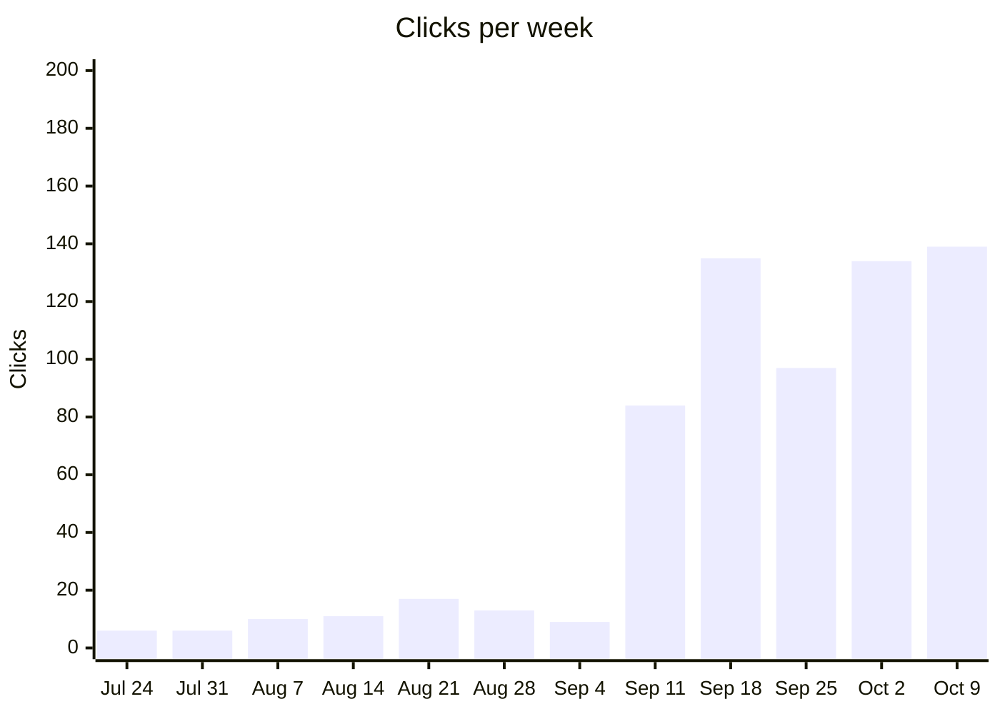

Jul 24: 6 · Jul 31: 6 · Aug 7: 10 · Aug 14: 11 · Aug 21: 17 · Aug 28: 13 · Sep 4: 9 · Sep 11: 84 · Sep 18: 135 · Sep 25: 97 · Oct 2: 134 · Oct 9: 139

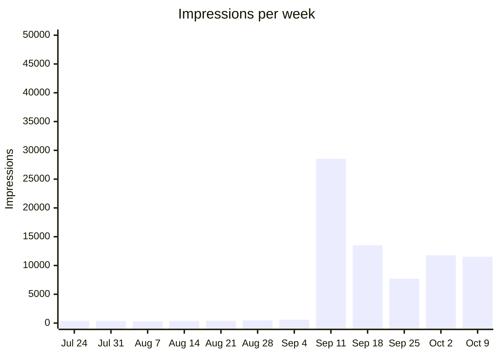

Jul 24: 357 · Jul 31: 349 · Aug 7: 279 · Aug 14: 368 · Aug 21: 392 · Aug 28: 474 · Sep 4: 601 · Sep 11: 28,541 · Sep 18: 13,529 · Sep 25: 7,711 · Oct 2: 11,776 · Oct 9: 11,513

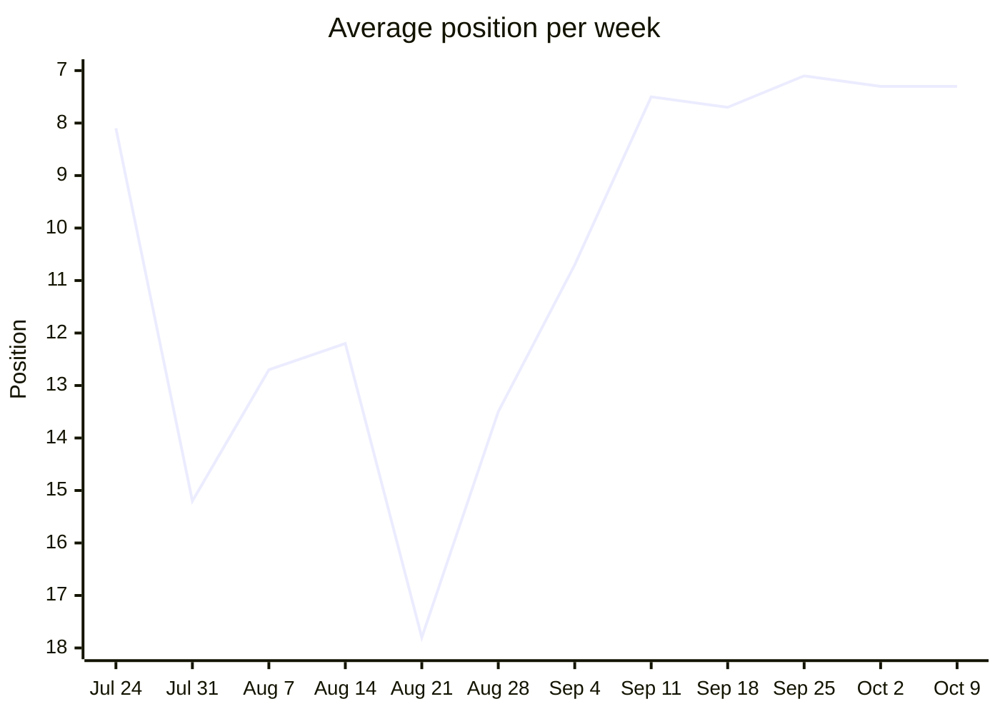

Jul 24: 8.1 · Jul 31: 15.2 · Aug 7: 12.7 · Aug 14: 12.2 · Aug 21: 17.8 · Aug 28: 13.5 · Sep 4: 10.7 · Sep 11: 7.5 · Sep 18: 7.7 · Sep 25: 7.1 · Oct 2: 7.3 · Oct 9: 7.3

Lower is better. The axis runs from the worst position at the bottom to the best at the top, so a rising line is a gain.

### Queries by position

How many queries averaged each rank that week. Search Console leaves rare queries out of query rows, so these add up to less than every search.

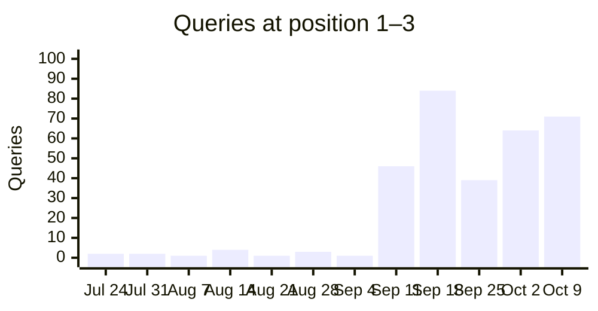

Jul 24: 2 · Jul 31: 2 · Aug 7: 1 · Aug 14: 4 · Aug 21: 1 · Aug 28: 3 · Sep 4: 1 · Sep 11: 46 · Sep 18: 84 · Sep 25: 39 · Oct 2: 64 · Oct 9: 71

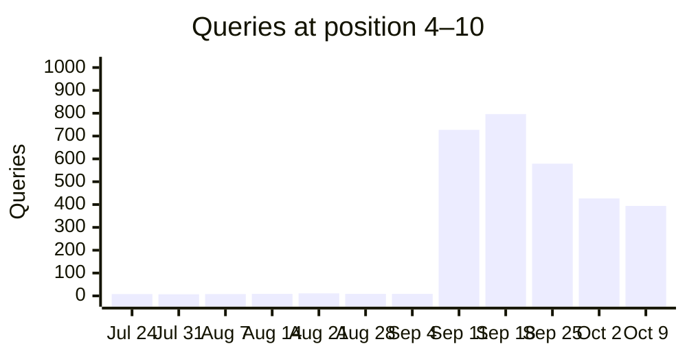

Jul 24: 8 · Jul 31: 7 · Aug 7: 8 · Aug 14: 9 · Aug 21: 11 · Aug 28: 9 · Sep 4: 9 · Sep 11: 727 · Sep 18: 796 · Sep 25: 579 · Oct 2: 427 · Oct 9: 394

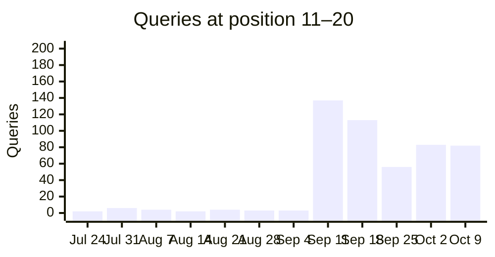

Jul 24: 2 · Jul 31: 6 · Aug 7: 4 · Aug 14: 2 · Aug 21: 4 · Aug 28: 3 · Sep 4: 3 · Sep 11: 137 · Sep 18: 113 · Sep 25: 56 · Oct 2: 83 · Oct 9: 82

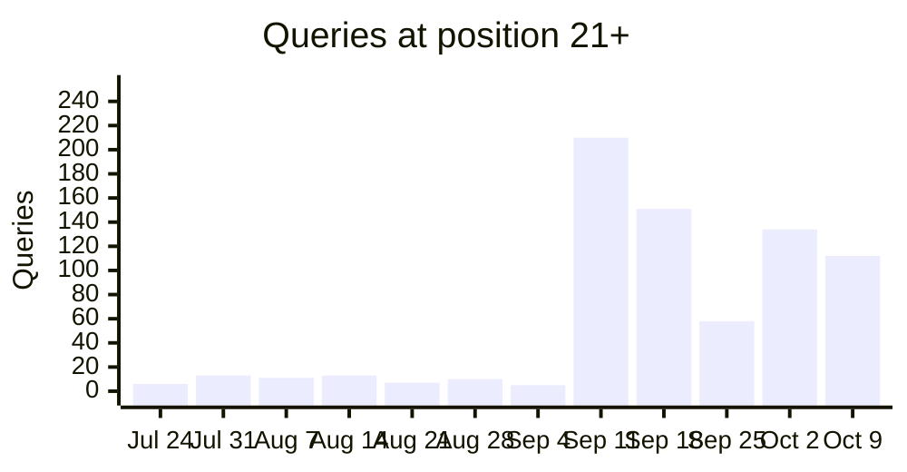

Jul 24: 6 · Jul 31: 13 · Aug 7: 11 · Aug 14: 13 · Aug 21: 7 · Aug 28: 10 · Sep 4: 5 · Sep 11: 210 · Sep 18: 151 · Sep 25: 58 · Oct 2: 134 · Oct 9: 112

### Tracked keywords over time

Average position per week for the tracked keywords seen in at least 3 weeks, the 6 with the most impressions first. Weeks the keyword was not seen are skipped, so the points are not always evenly spaced in time. 9 more have enough weeks but fewer impressions. 16 more were seen in fewer than 3 weeks.

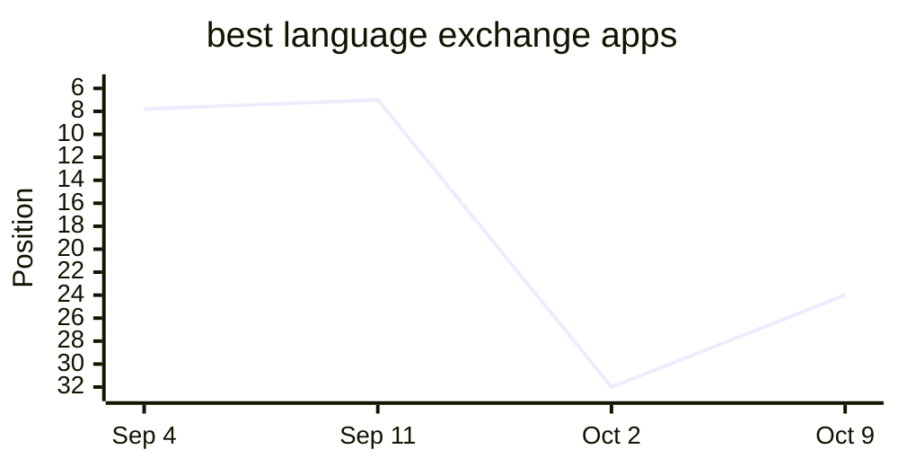

Sep 4: 7.8 · Sep 11: 7.0 · Oct 2: 32.0 · Oct 9: 24.0

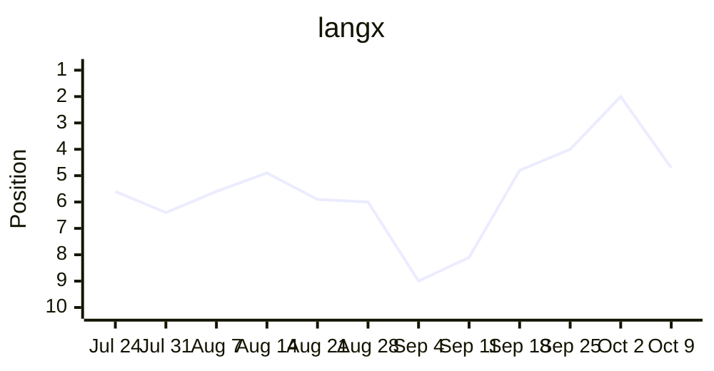

Jul 24: 5.6 · Jul 31: 6.4 · Aug 7: 5.6 · Aug 14: 4.9 · Aug 21: 5.9 · Aug 28: 6.0 · Sep 4: 9.0 · Sep 11: 8.1 · Sep 18: 4.8 · Sep 25: 4.0 · Oct 2: 2.0 · Oct 9: 4.7

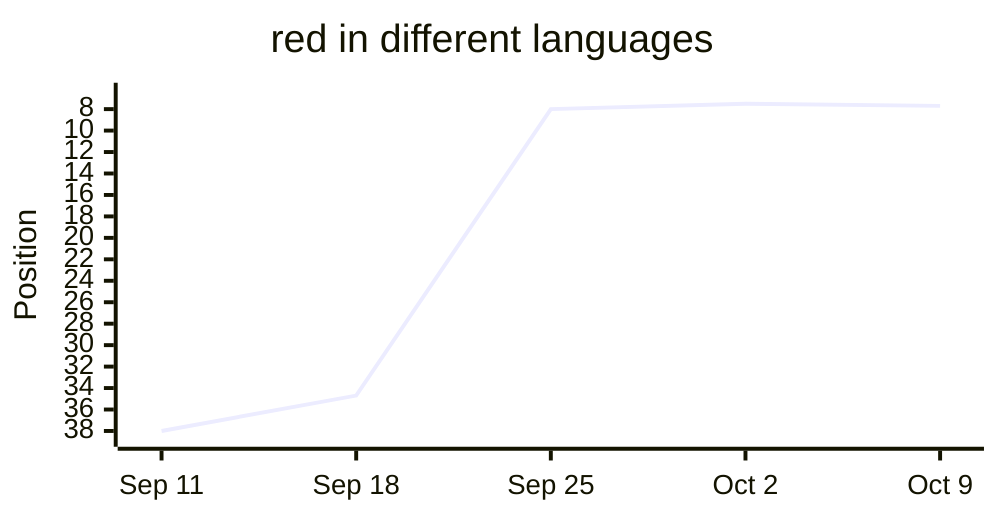

Sep 11: 38.0 · Sep 18: 34.7 · Sep 25: 8.0 · Oct 2: 7.5 · Oct 9: 7.7

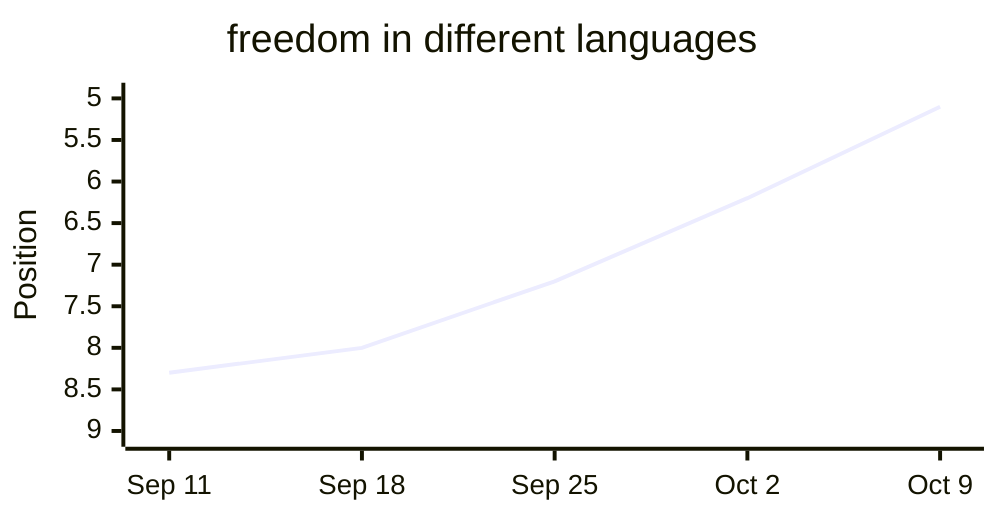

Sep 11: 8.3 · Sep 18: 8.0 · Sep 25: 7.2 · Oct 2: 6.2 · Oct 9: 5.1

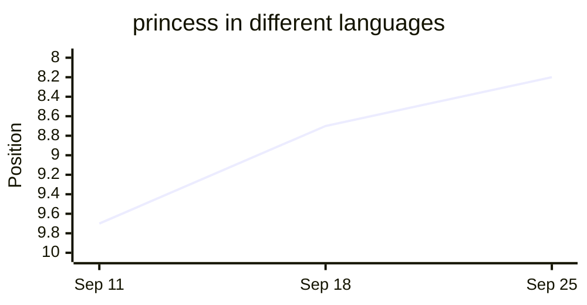

Sep 11: 9.7 · Sep 18: 8.7 · Sep 25: 8.2

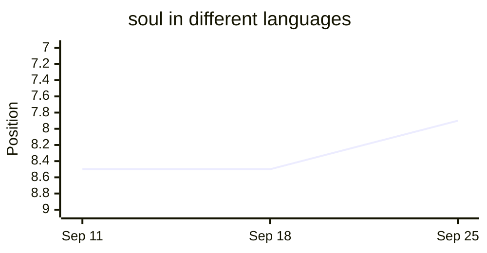

Sep 11: 8.5 · Sep 18: 8.5 · Sep 25: 7.9

## Tracked keywords

| Keyword | Position | Clicks | Impressions |
| --- | --- | --- | --- |
| langx | 4.7 (↓2.7) | 25 | 86 |
| langx app | — | 0 | 0 |
| language exchange app | 22.0 (↑18.8) | 0 | 18 |
| free language exchange app | — | 0 | 0 |
| open source language exchange app | — | 0 | 0 |
| best language exchange apps | 24.0 (↑8.0) | 0 | 9 |
| best language exchange app | 33.0 (↑7.0) | 0 | 1 |
| tandem alternative | 1.0 (↑10.0) | 1 | 1 |
| hellotalk alternative | 18.0 | 0 | 1 |
| apps like hellotalk | 43.4 (↑0.6) | 0 | 5 |
| tandem vs hellotalk | 13.8 | 0 | 6 |
| hellotalk vs tandem | — | 0 | 0 |
| is hellotalk free | — (was 8.7) | 0 | 0 |
| is tandem free | — | 0 | 0 |
| language exchange partner online | — | 0 | 0 |
| how to find a language exchange partner | — | 0 | 0 |
| what is a language exchange | 9.0 (↑36.0) | 0 | 2 |
| language exchange conversation topics | — | 0 | 0 |
| duolingo alternatives for speaking | — | 0 | 0 |
| how many words do you need to be fluent | — | 0 | 0 |
| most common words in spanish | — | 0 | 0 |
| spanish vocabulary test | — | 0 | 0 |
| guess the language game | — | 0 | 0 |
| open source alternative to tandem | — | 0 | 0 |
| open source alternative to hellotalk | — | 0 | 0 |
| langx vs tandem | — | 0 | 0 |
| langx vs hellotalk | — | 0 | 0 |
| social alternative to duolingo | — | 0 | 0 |
| duolingo with real people | — | 0 | 0 |
| social language learning apps | — | 0 | 0 |
| best language learning apps | 57.0 | 0 | 1 |
| free language learning apps | 19.0 | 0 | 1 |
| free language exchange apps | 5.0 | 0 | 1 |
| can you become fluent with duolingo | — | 0 | 0 |
| best language exchange apps 2026 | — | 0 | 0 |
| best language exchange apps for beginners | — | 0 | 0 |
| language exchange apps | 21.7 (↑8.6) | 0 | 18 |
| how long does it take to learn a language | — | 0 | 0 |
| easiest languages to learn for english speakers | — | 0 | 0 |
| shadowing technique | — | 0 | 0 |
| comprehensible input | — (was 57.4) | 0 | 0 |
| spaced repetition language learning | — | 0 | 0 |
| best pen pal apps | — | 0 | 0 |
| language exchange discord | — | 0 | 0 |
| language exchange meetup | — | 0 | 0 |
| is hellotalk safe | — | 0 | 0 |
| is tandem safe | — | 0 | 0 |
| malayalam alphabet | 8.0 (↓0.7) | 0 | 1 |
| most common tagalog words | — | 0 | 0 |
| most common afrikaans words | — | 0 | 0 |
| princess in different languages | — | 0 | 0 |
| freedom in different languages | 5.1 (↑1.1) | 0 | 87 |
| soul in different languages | — | 0 | 0 |
| aunt in different languages | — | 0 | 0 |
| boss in different languages | 4.7 (↑0.9) | 0 | 27 |
| red in different languages | 7.7 (↓0.2) | 1 | 187 |
| black in different languages | — | 0 | 0 |
| alone in other languages | 8.2 (↑0.8) | 0 | 30 |
| sword in different languages | 6.3 (↓0.6) | 0 | 12 |
| german speaking practice app | — | 0 | 0 |
| german conversation app | — | 0 | 0 |
| chinese conversation app | — | 0 | 0 |
| apps to practice speaking french | — | 0 | 0 |

## Top queries

| Query | Position | Clicks | Impressions | CTR |
| --- | --- | --- | --- | --- |
| langx | 4.7 (↓2.7) | 25 | 86 | 29.1% |
| sun in different languages | 5.8 (↑1.3) | 3 | 159 | 1.9% |
| lang x | 2.4 (↑1.3) | 2 | 22 | 9.1% |
| red in different languages | 7.7 (↓0.2) | 1 | 187 | 0.5% |
| duolingo open source | 9.7 (↓1.3) | 1 | 11 | 9.1% |
| librelingorelive | 4.5 (↑2.7) | 1 | 11 | 9.1% |
| how to say sun in different languages | 5.3 (↑2.6) | 1 | 7 | 14.3% |
| bomb in different languages | 5.0 (=) | 1 | 2 | 50.0% |
| any more | 3.0 | 1 | 1 | 100.0% |
| any other | 1.0 | 1 | 1 | 100.0% |
| holy in other languages | 6.0 | 1 | 1 | 100.0% |
| tandem alternative | 1.0 (↑10.0) | 1 | 1 | 100.0% |
| which one is best | 2.0 | 1 | 1 | 100.0% |
| night in different languages | 6.1 (↓0.2) | 0 | 112 | 0.0% |
| red in other languages | 7.7 (↑0.1) | 0 | 103 | 0.0% |
| freedom in different languages | 5.1 (↑1.1) | 0 | 87 | 0.0% |
| night in other languages | 5.8 (↓0.1) | 0 | 76 | 0.0% |
| sun in other languages | 6.5 (↑1.6) | 0 | 66 | 0.0% |
| town in spanish duolingo | 9.8 (↑0.2) | 0 | 66 | 0.0% |
| langx サインイン | 6.3 (↓1.0) | 0 | 42 | 0.0% |
| freedom in other languages | 6.3 (↑0.1) | 0 | 33 | 0.0% |
| language exchange meaning | 8.8 (↓0.2) | 0 | 32 | 0.0% |
| alone in different languages | 6.0 (↓0.1) | 0 | 31 | 0.0% |
| language exchange | 8.5 (↑13.8) | 0 | 31 | 0.0% |
| alone in other languages | 8.2 (↑0.8) | 0 | 30 | 0.0% |

## Moved up

| Query | Position | Impressions |
| --- | --- | --- |
| sun in other languages | 8.1 → 6.5 | 66 |
| sun in different languages | 7.1 → 5.8 | 159 |
| freedom in different languages | 6.2 → 5.1 | 87 |

## Moved down

| Query | Position | Impressions |
| --- | --- | --- |
| langx | 2.0 → 4.7 | 86 |
| beauty in different languages | 5.9 → 8.4 | 25 |
| langx サインイン | 5.3 → 6.3 | 42 |

## Close to page one

| Query | Position | Impressions | Clicks |
| --- | --- | --- | --- |
| town in spanish duolingo | 9.8 | 66 | 0 |
| language exchange meaning | 8.8 | 32 | 0 |
| language exchange | 8.5 | 31 | 0 |
| alone in other languages | 8.2 | 30 | 0 |
| r duolingo | 8.0 | 27 | 0 |
| beauty in different languages | 8.4 | 25 | 0 |

## New this week

| Query | Position | Impressions |
| --- | --- | --- |
| best language learning app | 7.0 | 20 |

## Top pages

| Page | Position | Clicks | Impressions | CTR |
| --- | --- | --- | --- | --- |
| / | 5.0 (↓1.4) | 31 | 299 | 10.4% |
| /tools/say/sun | 6.1 (↑1.0) | 6 | 486 | 1.2% |
| https://app.langx.io/ | 6.7 (↓0.5) | 5 | 132 | 3.8% |
| /language-exchange-conversation-topics | 7.6 (↑0.4) | 5 | 125 | 4.0% |
| /free-language-exchange-apps | 6.9 (↓2.1) | 5 | 105 | 4.8% |
| /open-source-alternative-to-duolingo | 6.0 (↑0.7) | 4 | 130 | 3.1% |
| /best-language-exchange-apps | 11.8 (↓0.8) | 2 | 283 | 0.7% |
| /open-source-alternative-to-interpals | 8.1 (↓0.1) | 2 | 40 | 5.0% |
| /open-source-alternative-to-speaky | 8.5 (↓1.1) | 2 | 24 | 8.3% |
| /tools/similar/croatian-and-polish | 6.2 (=) | 2 | 12 | 16.7% |
| /tools/most-common-words/chinese | 4.0 (↑1.5) | 2 | 11 | 18.2% |
| /tools/say/whore | 7.8 (↓0.8) | 2 | 9 | 22.2% |
| /tools/vocabulary-test/malay | 5.3 (↑16.7) | 2 | 3 | 66.7% |
| /tools/say/red | 7.5 (↓0.1) | 1 | 579 | 0.2% |
| /tools/say/freedom | 5.6 (↑0.7) | 1 | 276 | 0.4% |
| /best-apps-to-practice-german-with-native-speakers | 7.9 (↓0.6) | 1 | 165 | 0.6% |
| /what-is-a-language-exchange | 8.1 (↑1.6) | 1 | 165 | 0.6% |
| /best-apps-to-practice-arabic-with-native-speakers | 7.4 (↓0.6) | 1 | 160 | 0.6% |
| /best-apps-to-practice-turkish-with-native-speakers | 7.3 (↓1.4) | 1 | 138 | 0.7% |
| /tools/say/milk | 8.9 (↑0.2) | 1 | 119 | 0.8% |
| /tools/say/everything | 5.3 (↑0.6) | 1 | 100 | 1.0% |
| /tools/say/sit | 6.0 (↓0.2) | 1 | 99 | 1.0% |
| /tools/say/tired | 5.9 (↑0.6) | 1 | 94 | 1.1% |
| /tools/say/dangerous | 6.7 (↓0.3) | 1 | 85 | 1.2% |
| /tools/say/universe | 5.6 (↑0.1) | 1 | 83 | 1.2% |

