# langx.io rankings, 2026-10-10 to 2026-10-16

Google Search Console, web search, property `sc-domain:langx.io`. Compared with 2026-10-03 to 2026-10-09. Position is the average rank when the page was shown; ↑ means it moved up. Queries with fewer than 20 impressions in either week are left out of the movers, since one search can swing them by whole places. Google hides rare queries, so a tracked keyword can be missing even when the page ranks for it.

## Totals

|  | This week | Week before |
| --- | --- | --- |
| Clicks | 214 | 139 |
| Impressions | 14,211 | 11,513 |
| CTR | 1.5% | 1.2% |
| Average position | 6.8 | 7.3 |

## Trends

The last 12 weeks, 2026-07-25 to 2026-10-16. Each point is the seven days ending on the date shown; the last one is this report’s week.

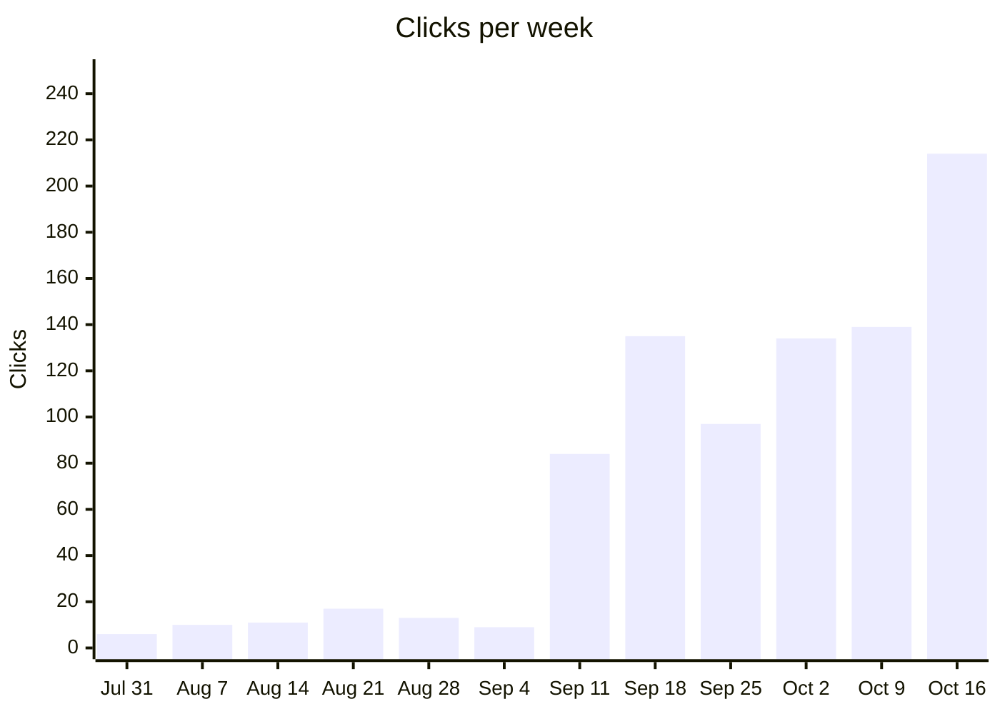

Jul 31: 6 · Aug 7: 10 · Aug 14: 11 · Aug 21: 17 · Aug 28: 13 · Sep 4: 9 · Sep 11: 84 · Sep 18: 135 · Sep 25: 97 · Oct 2: 134 · Oct 9: 139 · Oct 16: 214

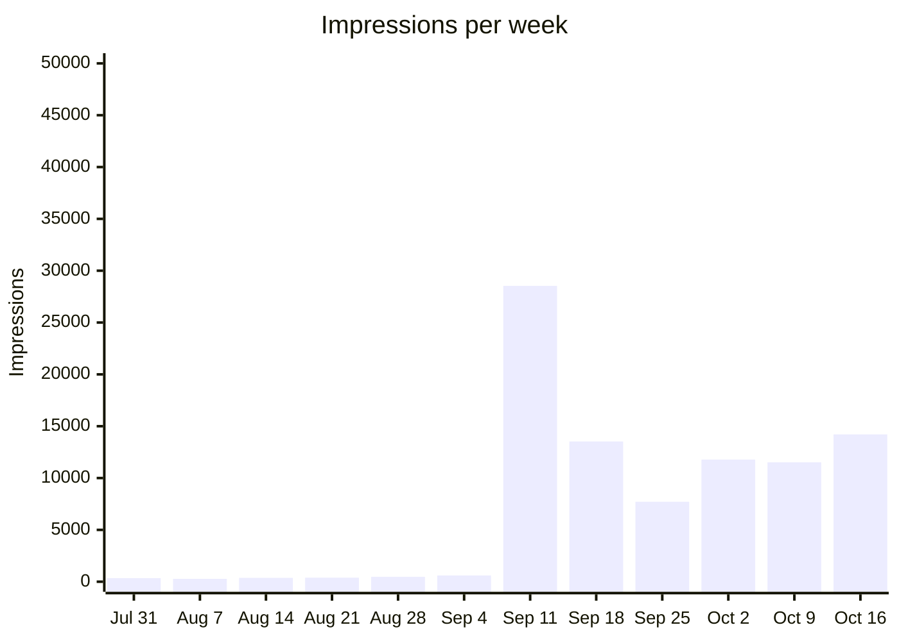

Jul 31: 349 · Aug 7: 279 · Aug 14: 368 · Aug 21: 392 · Aug 28: 474 · Sep 4: 601 · Sep 11: 28,541 · Sep 18: 13,529 · Sep 25: 7,711 · Oct 2: 11,776 · Oct 9: 11,513 · Oct 16: 14,211

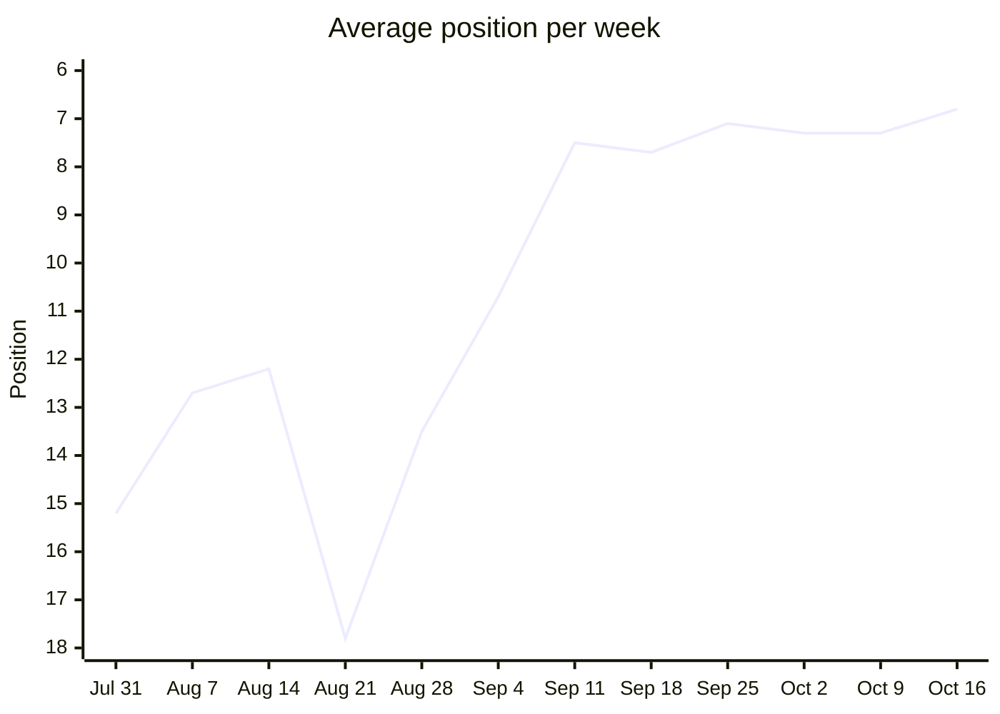

Jul 31: 15.2 · Aug 7: 12.7 · Aug 14: 12.2 · Aug 21: 17.8 · Aug 28: 13.5 · Sep 4: 10.7 · Sep 11: 7.5 · Sep 18: 7.7 · Sep 25: 7.1 · Oct 2: 7.3 · Oct 9: 7.3 · Oct 16: 6.8

Lower is better. The axis runs from the worst position at the bottom to the best at the top, so a rising line is a gain.

### Queries by position

How many queries averaged each rank that week. Search Console leaves rare queries out of query rows, so these add up to less than every search.

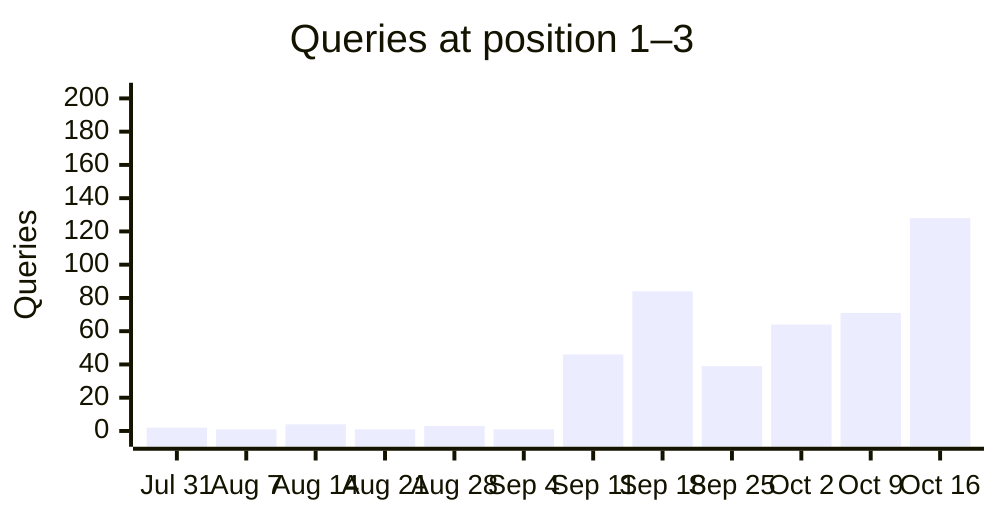

Jul 31: 2 · Aug 7: 1 · Aug 14: 4 · Aug 21: 1 · Aug 28: 3 · Sep 4: 1 · Sep 11: 46 · Sep 18: 84 · Sep 25: 39 · Oct 2: 64 · Oct 9: 71 · Oct 16: 128

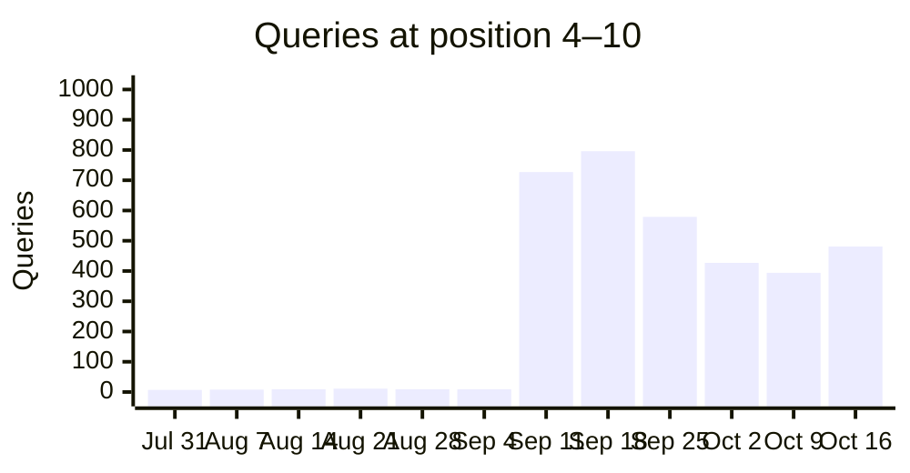

Jul 31: 7 · Aug 7: 8 · Aug 14: 9 · Aug 21: 11 · Aug 28: 9 · Sep 4: 9 · Sep 11: 727 · Sep 18: 796 · Sep 25: 579 · Oct 2: 427 · Oct 9: 394 · Oct 16: 481

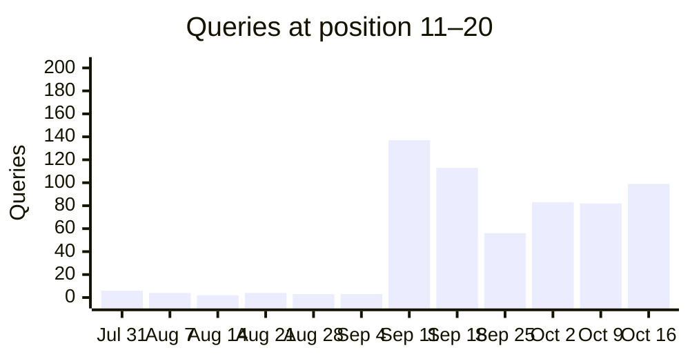

Jul 31: 6 · Aug 7: 4 · Aug 14: 2 · Aug 21: 4 · Aug 28: 3 · Sep 4: 3 · Sep 11: 137 · Sep 18: 113 · Sep 25: 56 · Oct 2: 83 · Oct 9: 82 · Oct 16: 99

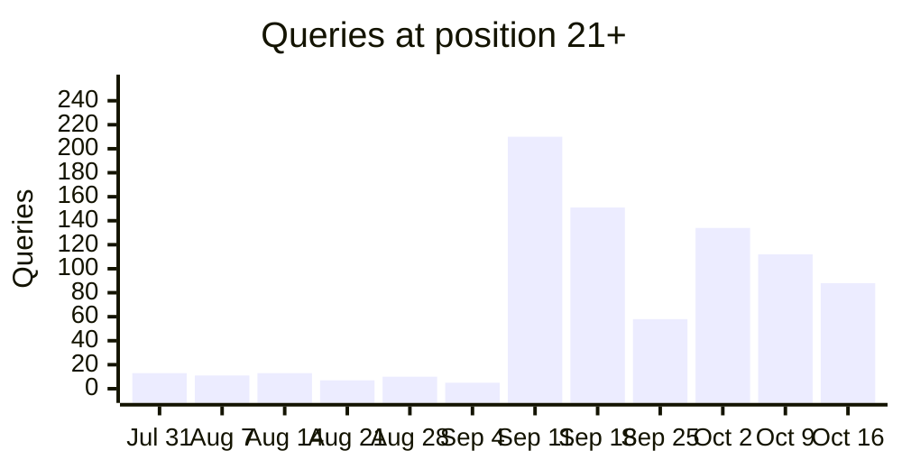

Jul 31: 13 · Aug 7: 11 · Aug 14: 13 · Aug 21: 7 · Aug 28: 10 · Sep 4: 5 · Sep 11: 210 · Sep 18: 151 · Sep 25: 58 · Oct 2: 134 · Oct 9: 112 · Oct 16: 88

### Tracked keywords over time

Average position per week for the tracked keywords seen in at least 3 weeks, the 6 with the most impressions first. Weeks the keyword was not seen are skipped, so the points are not always evenly spaced in time. 12 more have enough weeks but fewer impressions. 17 more were seen in fewer than 3 weeks.

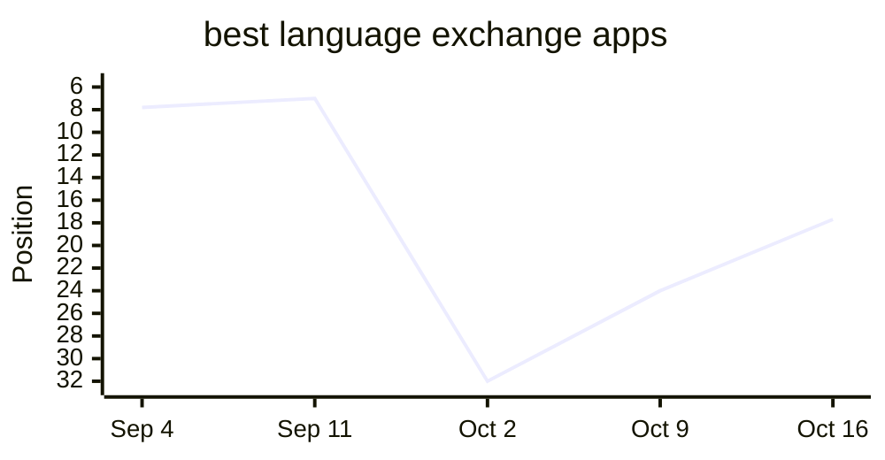

Sep 4: 7.8 · Sep 11: 7.0 · Oct 2: 32.0 · Oct 9: 24.0 · Oct 16: 17.7

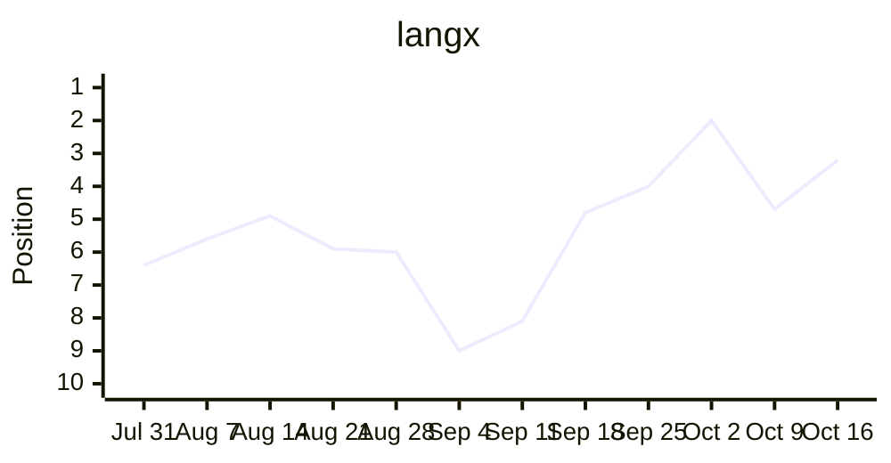

Jul 31: 6.4 · Aug 7: 5.6 · Aug 14: 4.9 · Aug 21: 5.9 · Aug 28: 6.0 · Sep 4: 9.0 · Sep 11: 8.1 · Sep 18: 4.8 · Sep 25: 4.0 · Oct 2: 2.0 · Oct 9: 4.7 · Oct 16: 3.2

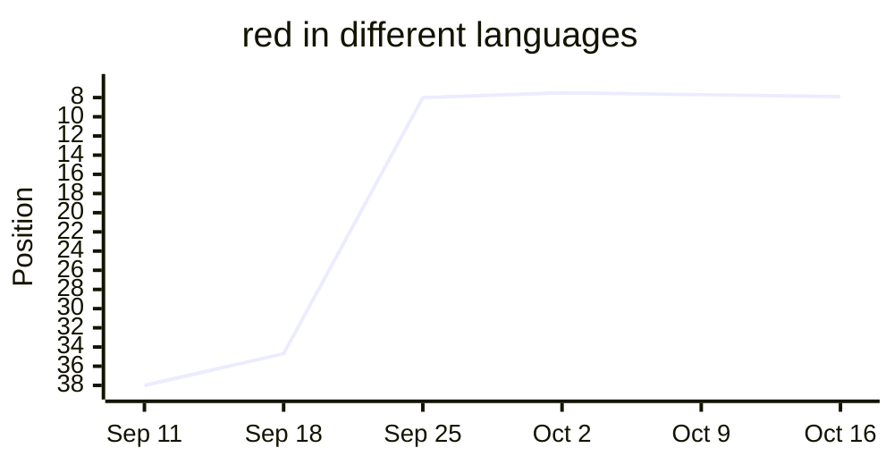

Sep 11: 38.0 · Sep 18: 34.7 · Sep 25: 8.0 · Oct 2: 7.5 · Oct 9: 7.7 · Oct 16: 7.9

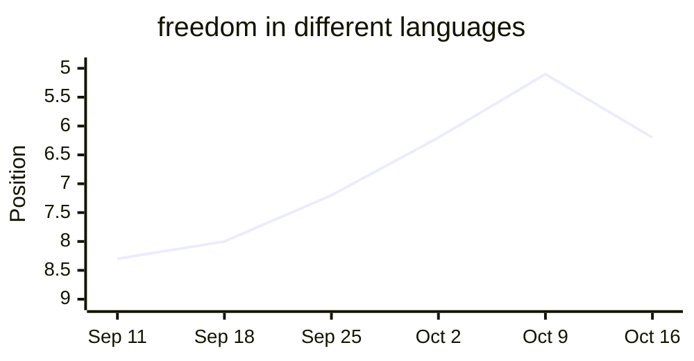

Sep 11: 8.3 · Sep 18: 8.0 · Sep 25: 7.2 · Oct 2: 6.2 · Oct 9: 5.1 · Oct 16: 6.2

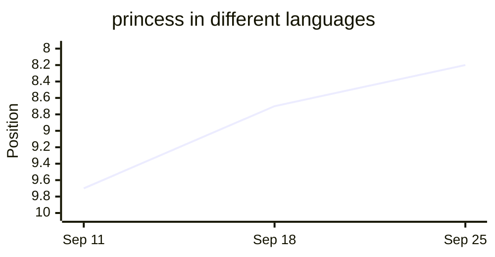

Sep 11: 9.7 · Sep 18: 8.7 · Sep 25: 8.2

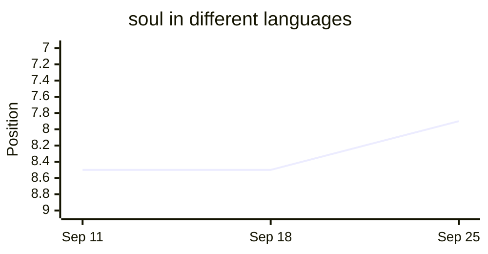

Sep 11: 8.5 · Sep 18: 8.5 · Sep 25: 7.9

## Tracked keywords

| Keyword | Position | Clicks | Impressions |
| --- | --- | --- | --- |
| langx | 3.2 (↑1.5) | 27 | 96 |
| langx app | — | 0 | 0 |
| language exchange app | 8.3 (↑13.7) | 0 | 28 |
| free language exchange app | — | 0 | 0 |
| open source language exchange app | — | 0 | 0 |
| best language exchange apps | 17.7 (↑6.3) | 0 | 34 |
| best language exchange app | 14.0 (↑19.0) | 0 | 4 |
| tandem alternative | 7.1 (↓6.1) | 0 | 7 |
| hellotalk alternative | 12.0 (↑6.0) | 0 | 1 |
| apps like hellotalk | 37.0 (↑6.4) | 0 | 1 |
| tandem vs hellotalk | 12.3 (↑1.6) | 0 | 4 |
| hellotalk vs tandem | 11.0 | 0 | 3 |
| is hellotalk free | — | 0 | 0 |
| is tandem free | 5.0 | 0 | 14 |
| language exchange partner online | — | 0 | 0 |
| how to find a language exchange partner | — | 0 | 0 |
| what is a language exchange | 8.2 (↑0.8) | 0 | 10 |
| language exchange conversation topics | — | 0 | 0 |
| duolingo alternatives for speaking | — | 0 | 0 |
| how many words do you need to be fluent | — | 0 | 0 |
| most common words in spanish | — | 0 | 0 |
| spanish vocabulary test | — | 0 | 0 |
| guess the language game | — | 0 | 0 |
| open source alternative to tandem | — | 0 | 0 |
| open source alternative to hellotalk | — | 0 | 0 |
| langx vs tandem | — | 0 | 0 |
| langx vs hellotalk | — | 0 | 0 |
| social alternative to duolingo | — | 0 | 0 |
| duolingo with real people | — | 0 | 0 |
| social language learning apps | — | 0 | 0 |
| best language learning apps | 46.0 (↑11.0) | 0 | 1 |
| free language learning apps | 10.8 (↑8.2) | 0 | 5 |
| free language exchange apps | 10.5 (↓5.5) | 0 | 4 |
| can you become fluent with duolingo | — | 0 | 0 |
| best language exchange apps 2026 | — | 0 | 0 |
| best language exchange apps for beginners | — | 0 | 0 |
| language exchange apps | 13.8 (↑7.9) | 0 | 15 |
| how long does it take to learn a language | — | 0 | 0 |
| easiest languages to learn for english speakers | — | 0 | 0 |
| shadowing technique | — | 0 | 0 |
| comprehensible input | — | 0 | 0 |
| spaced repetition language learning | — | 0 | 0 |
| best pen pal apps | — | 0 | 0 |
| language exchange discord | 8.4 | 0 | 59 |
| language exchange meetup | — | 0 | 0 |
| is hellotalk safe | — | 0 | 0 |
| is tandem safe | 6.9 | 0 | 14 |
| malayalam alphabet | — (was 8.0) | 0 | 0 |
| most common tagalog words | — | 0 | 0 |
| most common afrikaans words | — | 0 | 0 |
| princess in different languages | — | 0 | 0 |
| freedom in different languages | 6.2 (↓1.1) | 0 | 77 |
| soul in different languages | — | 0 | 0 |
| aunt in different languages | — | 0 | 0 |
| boss in different languages | 5.9 (↓1.2) | 0 | 31 |
| red in different languages | 7.9 (↓0.3) | 1 | 138 |
| black in different languages | — | 0 | 0 |
| alone in other languages | 6.1 (↑2.2) | 0 | 17 |
| sword in different languages | 6.9 (↓0.6) | 0 | 18 |
| german speaking practice app | — | 0 | 0 |
| german conversation app | — | 0 | 0 |
| chinese conversation app | — | 0 | 0 |
| apps to practice speaking french | — | 0 | 0 |

## Top queries

| Query | Position | Clicks | Impressions | CTR |
| --- | --- | --- | --- | --- |
| langx | 3.2 (↑1.5) | 27 | 96 | 28.1% |
| night in different languages | 5.7 (↑0.3) | 3 | 85 | 3.5% |
| duolingo open source | 6.4 (↑3.3) | 3 | 40 | 7.5% |
| red in other languages | 7.4 (↑0.3) | 2 | 77 | 2.6% |
| open source duolingo alternative | 3.0 (↑1.8) | 2 | 14 | 14.3% |
| language exchange topics | 6.5 (↑1.8) | 2 | 12 | 16.7% |
| sun in different languages | 7.4 (↓1.6) | 1 | 158 | 0.6% |
| red in different languages | 7.9 (↓0.3) | 1 | 138 | 0.7% |
| open source duolingo | 6.0 (↑2.4) | 1 | 41 | 2.4% |
| free in other languages | 5.0 (↑3.7) | 1 | 12 | 8.3% |
| topics for language exchange | 6.1 (↑7.5) | 1 | 8 | 12.5% |
| apps like tandem | 6.3 (↑12.0) | 1 | 3 | 33.3% |
| langx speaking | 4.3 (↓1.8) | 1 | 3 | 33.3% |
| english exchange app | 9.5 | 1 | 2 | 50.0% |
| language exchange questions | 7.5 (↓0.5) | 1 | 2 | 50.0% |
| bunlar ücretli mi | 1.0 | 1 | 1 | 100.0% |
| free ones | 3.0 | 1 | 1 | 100.0% |
| gratis | 1.0 | 1 | 1 | 100.0% |
| how to get tandem pro for free | 2.0 | 1 | 1 | 100.0% |
| like duolingo | 3.0 | 1 | 1 | 100.0% |
| on playstore | 2.0 | 1 | 1 | 100.0% |
| opensource ? | 13.0 | 1 | 1 | 100.0% |
| other apps like hellotalk | 3.0 | 1 | 1 | 100.0% |
| outro aplicativo | 2.0 | 1 | 1 | 100.0% |
| welche kostenlosen alternativen gibt es | 3.0 | 1 | 1 | 100.0% |

## Moved up

| Query | Position | Impressions |
| --- | --- | --- |
| language exchange | 8.5 → 4.1 | 234 |
| beauty in different languages | 8.4 → 6.1 | 28 |
| langx サインイン | 6.3 → 4.2 | 20 |
| langx | 4.7 → 3.2 | 96 |

## Moved down

| Query | Position | Impressions |
| --- | --- | --- |
| words for sun in other languages | 5.3 → 7.6 | 25 |
| sun in different languages | 5.8 → 7.4 | 158 |
| sun in other languages | 6.5 → 7.9 | 66 |
| boss in different languages | 4.7 → 5.9 | 31 |
| freedom in different languages | 5.1 → 6.2 | 77 |

## Close to page one

| Query | Position | Impressions | Clicks |
| --- | --- | --- | --- |
| town in spanish duolingo | 9.7 | 62 | 0 |
| language exchange discord | 8.4 | 59 | 0 |
| best language exchange apps | 17.7 | 34 | 0 |
| language exchange meaning | 8.4 | 34 | 0 |
| language exchange app | 8.3 | 28 | 0 |
| armenian alphabet | 13.2 | 24 | 0 |
| best free language learning apps | 13.8 | 22 | 0 |
| what is language exchange | 8.8 | 22 | 0 |

## New this week

| Query | Position | Impressions |
| --- | --- | --- |
| language exchange discord | 8.4 | 59 |
| langexists | 5.6 | 32 |

## Top pages

| Page | Position | Clicks | Impressions | CTR |
| --- | --- | --- | --- | --- |
| / | 3.8 (↑1.1) | 47 | 425 | 11.1% |
| /best-language-exchange-apps | 6.1 (↑5.7) | 19 | 690 | 2.8% |
| /open-source-alternative-to-duolingo | 4.9 (↑1.0) | 18 | 368 | 4.9% |
| /language-exchange-conversation-topics | 6.6 (↑1.0) | 13 | 242 | 5.4% |
| /free-language-learning-apps | 8.5 (=) | 7 | 346 | 2.0% |
| /tools/say/red | 7.5 (=) | 5 | 486 | 1.0% |
| https://app.langx.io/ | 6.9 (↓0.3) | 5 | 79 | 6.3% |
| /tools/say/sun | 7.2 (↓1.1) | 4 | 556 | 0.7% |
| /tools/similar/catalan-and-romanian | 5.3 (=) | 4 | 15 | 26.7% |
| /is-tandem-safe | 5.8 (↑0.8) | 3 | 410 | 0.7% |
| /tools/say/night | 5.8 (↑0.5) | 3 | 346 | 0.9% |
| /social-language-learning-apps | 5.5 (↑2.6) | 3 | 194 | 1.5% |
| /is-tandem-free | 5.3 (↓3.1) | 3 | 153 | 2.0% |
| /tools/most-common-words/chinese | 3.8 (↑0.2) | 3 | 17 | 17.6% |
| /tandem-vs-hellotalk | 6.0 (=) | 2 | 264 | 0.8% |
| /free-language-exchange-apps | 4.7 (↑2.3) | 2 | 239 | 0.8% |
| /best-apps-to-practice-japanese-with-native-speakers | 7.9 (↓0.4) | 2 | 165 | 1.2% |
| /best-apps-to-practice-arabic-with-native-speakers | 7.1 (↑0.4) | 2 | 158 | 1.3% |
| /tools/say/gift | 6.7 (↓0.4) | 2 | 132 | 1.5% |
| /Through-learning-languages-understanding-more-about-the-worlds-cultures | 8.0 (↓0.1) | 2 | 120 | 1.7% |
| /best-apps-to-practice-russian-with-native-speakers | 6.3 (↓0.6) | 2 | 76 | 2.6% |
| /open-source-alternative-to-tandem | 8.5 (↑2.0) | 2 | 75 | 2.7% |
| /tools/say/justice | 4.9 (↑0.8) | 2 | 28 | 7.1% |
| /tools/similar/danish-and-dutch | 4.3 (↑0.3) | 2 | 10 | 20.0% |
| /tools/vocabulary-test/indonesian | 3.3 (↑4.8) | 2 | 4 | 50.0% |

