# langx.io rankings, 2026-10-17 to 2026-10-23

Google Search Console, web search, property `sc-domain:langx.io`. Compared with 2026-10-10 to 2026-10-16. Position is the average rank when the page was shown; ↑ means it moved up. Queries with fewer than 20 impressions in either week are left out of the movers, since one search can swing them by whole places. Google hides rare queries, so a tracked keyword can be missing even when the page ranks for it.

## Totals

|  | This week | Week before |
| --- | --- | --- |
| Clicks | 191 | 214 |
| Impressions | 13,853 | 14,211 |
| CTR | 1.4% | 1.5% |
| Average position | 6.9 | 6.8 |

## Trends

The last 12 weeks, 2026-08-01 to 2026-10-23. Each point is the seven days ending on the date shown; the last one is this report’s week.

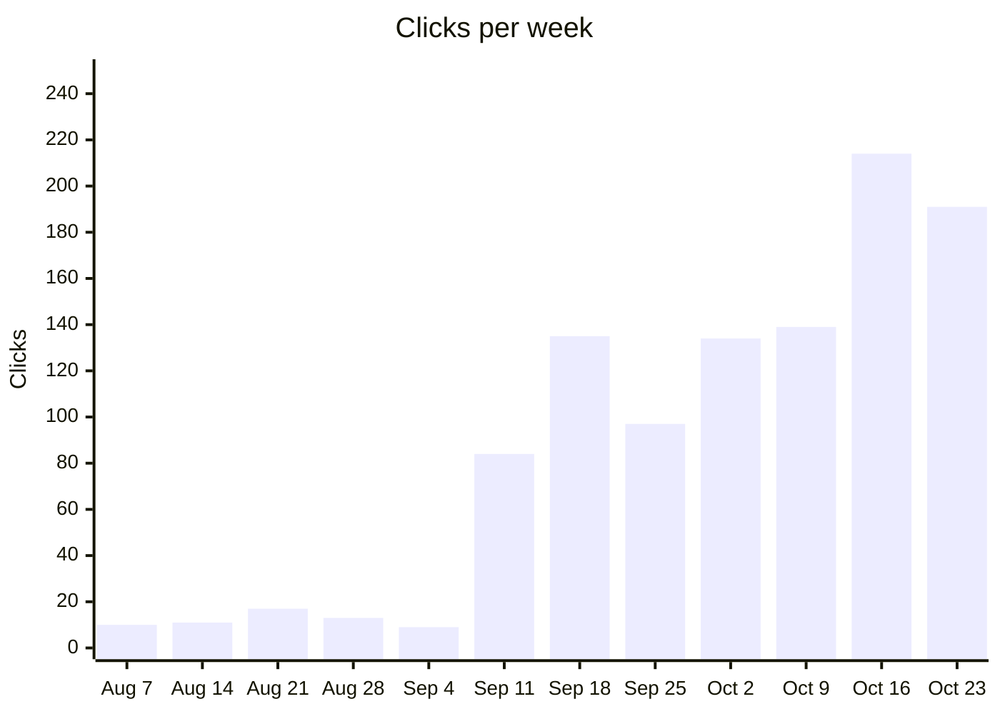

Aug 7: 10 · Aug 14: 11 · Aug 21: 17 · Aug 28: 13 · Sep 4: 9 · Sep 11: 84 · Sep 18: 135 · Sep 25: 97 · Oct 2: 134 · Oct 9: 139 · Oct 16: 214 · Oct 23: 191

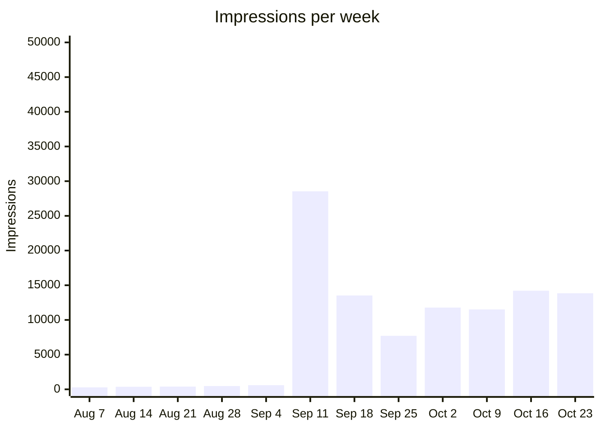

Aug 7: 279 · Aug 14: 368 · Aug 21: 392 · Aug 28: 474 · Sep 4: 601 · Sep 11: 28,541 · Sep 18: 13,529 · Sep 25: 7,711 · Oct 2: 11,776 · Oct 9: 11,513 · Oct 16: 14,211 · Oct 23: 13,853

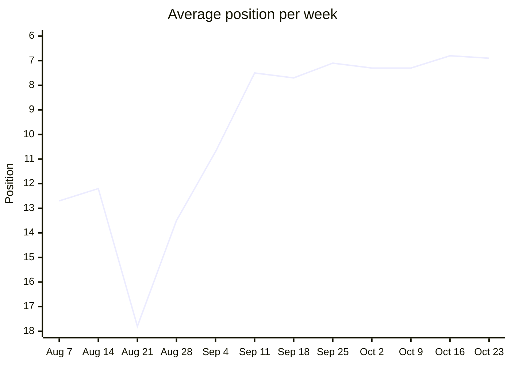

Aug 7: 12.7 · Aug 14: 12.2 · Aug 21: 17.8 · Aug 28: 13.5 · Sep 4: 10.7 · Sep 11: 7.5 · Sep 18: 7.7 · Sep 25: 7.1 · Oct 2: 7.3 · Oct 9: 7.3 · Oct 16: 6.8 · Oct 23: 6.9

Lower is better. The axis runs from the worst position at the bottom to the best at the top, so a rising line is a gain.

### Queries by position

How many queries averaged each rank that week. Search Console leaves rare queries out of query rows, so these add up to less than every search.

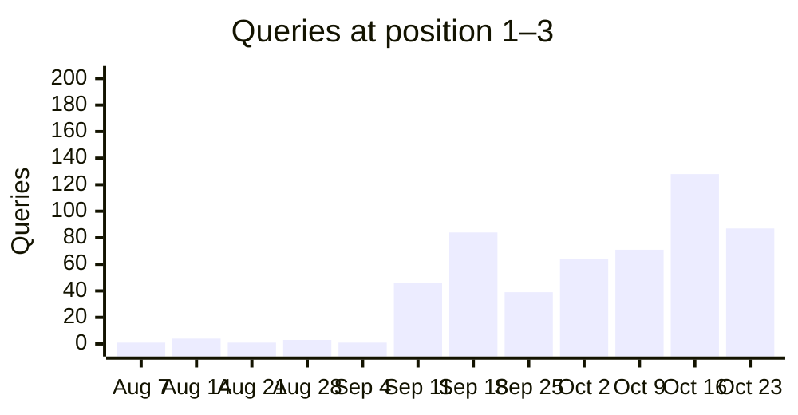

Aug 7: 1 · Aug 14: 4 · Aug 21: 1 · Aug 28: 3 · Sep 4: 1 · Sep 11: 46 · Sep 18: 84 · Sep 25: 39 · Oct 2: 64 · Oct 9: 71 · Oct 16: 128 · Oct 23: 87

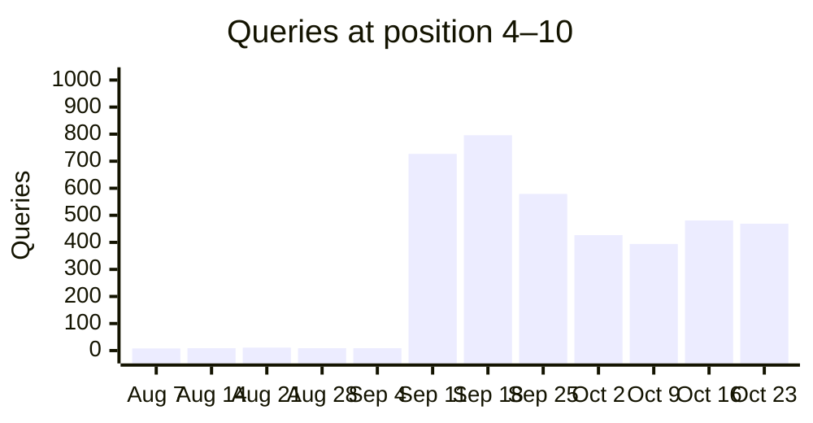

Aug 7: 8 · Aug 14: 9 · Aug 21: 11 · Aug 28: 9 · Sep 4: 9 · Sep 11: 727 · Sep 18: 796 · Sep 25: 579 · Oct 2: 427 · Oct 9: 394 · Oct 16: 481 · Oct 23: 469

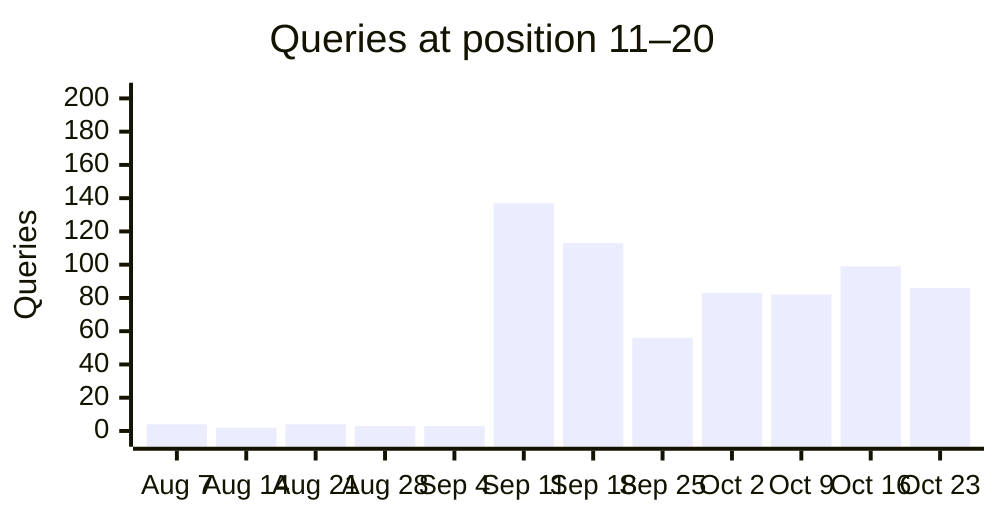

Aug 7: 4 · Aug 14: 2 · Aug 21: 4 · Aug 28: 3 · Sep 4: 3 · Sep 11: 137 · Sep 18: 113 · Sep 25: 56 · Oct 2: 83 · Oct 9: 82 · Oct 16: 99 · Oct 23: 86

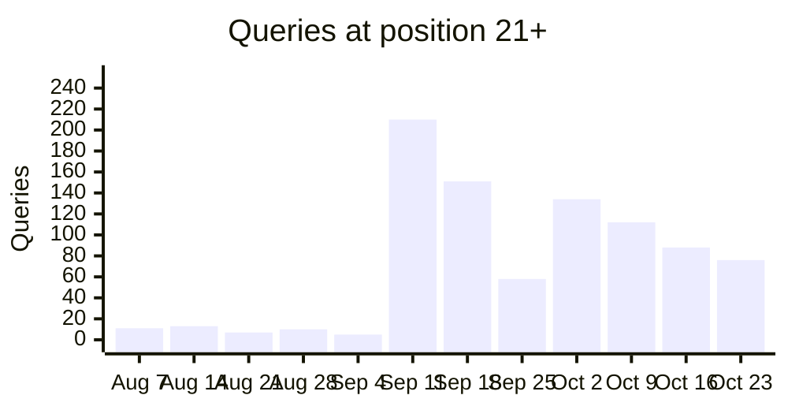

Aug 7: 11 · Aug 14: 13 · Aug 21: 7 · Aug 28: 10 · Sep 4: 5 · Sep 11: 210 · Sep 18: 151 · Sep 25: 58 · Oct 2: 134 · Oct 9: 112 · Oct 16: 88 · Oct 23: 76

### Tracked keywords over time

Average position per week for the tracked keywords seen in at least 3 weeks, the 6 with the most impressions first. Weeks the keyword was not seen are skipped, so the points are not always evenly spaced in time. 16 more have enough weeks but fewer impressions. 15 more were seen in fewer than 3 weeks.

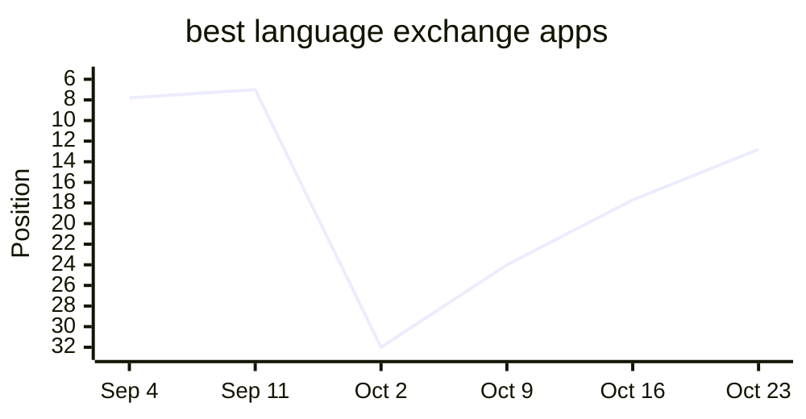

Sep 4: 7.8 · Sep 11: 7.0 · Oct 2: 32.0 · Oct 9: 24.0 · Oct 16: 17.7 · Oct 23: 12.8

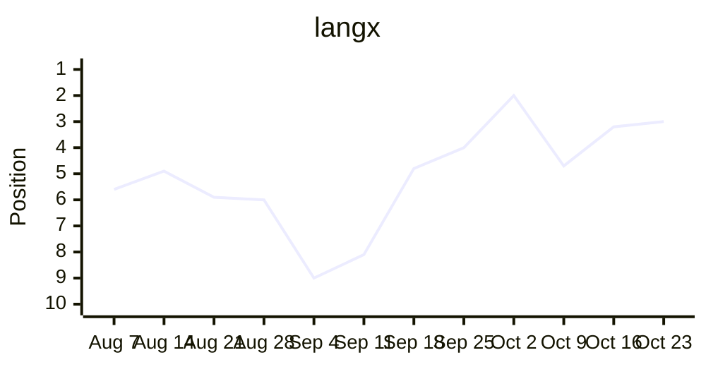

Aug 7: 5.6 · Aug 14: 4.9 · Aug 21: 5.9 · Aug 28: 6.0 · Sep 4: 9.0 · Sep 11: 8.1 · Sep 18: 4.8 · Sep 25: 4.0 · Oct 2: 2.0 · Oct 9: 4.7 · Oct 16: 3.2 · Oct 23: 3.0

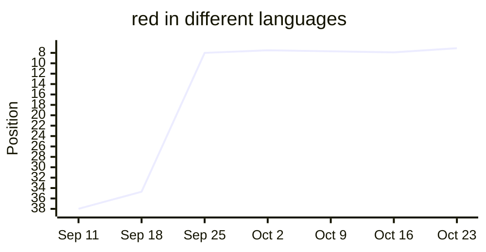

Sep 11: 38.0 · Sep 18: 34.7 · Sep 25: 8.0 · Oct 2: 7.5 · Oct 9: 7.7 · Oct 16: 7.9 · Oct 23: 7.1

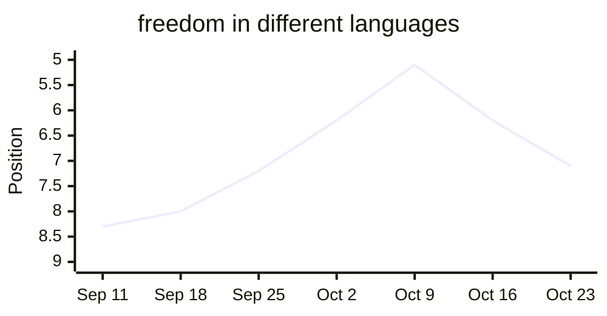

Sep 11: 8.3 · Sep 18: 8.0 · Sep 25: 7.2 · Oct 2: 6.2 · Oct 9: 5.1 · Oct 16: 6.2 · Oct 23: 7.1

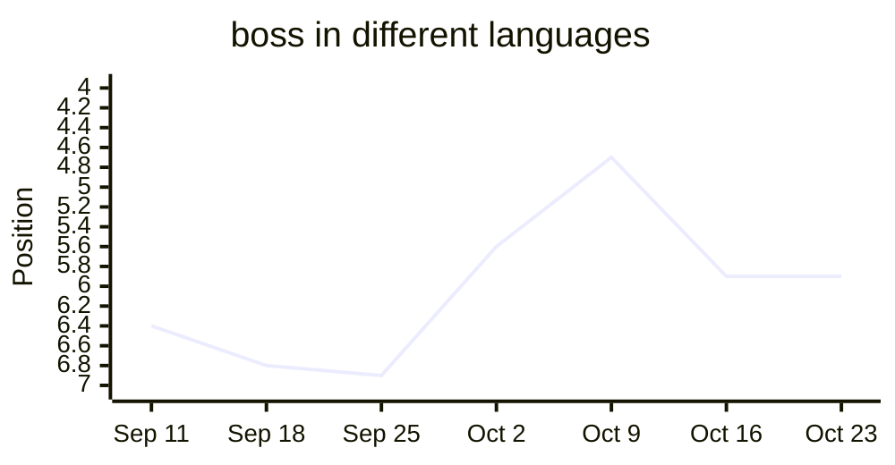

Sep 11: 6.4 · Sep 18: 6.8 · Sep 25: 6.9 · Oct 2: 5.6 · Oct 9: 4.7 · Oct 16: 5.9 · Oct 23: 5.9

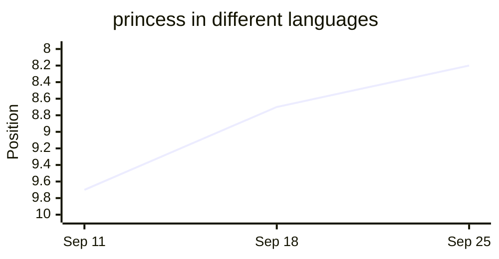

Sep 11: 9.7 · Sep 18: 8.7 · Sep 25: 8.2

## Tracked keywords

| Keyword | Position | Clicks | Impressions |
| --- | --- | --- | --- |
| langx | 3.0 (↑0.2) | 32 | 96 |
| langx app | — | 0 | 0 |
| language exchange app | 9.8 (↓1.5) | 0 | 16 |
| free language exchange app | — | 0 | 0 |
| open source language exchange app | — | 0 | 0 |
| best language exchange apps | 12.8 (↑4.9) | 0 | 75 |
| best language exchange app | 23.5 (↓9.5) | 0 | 2 |
| tandem alternative | 5.6 (↑1.5) | 0 | 5 |
| hellotalk alternative | — (was 12.0) | 0 | 0 |
| apps like hellotalk | 1.0 (↑36.0) | 1 | 4 |
| tandem vs hellotalk | 10.5 (↑1.8) | 0 | 12 |
| hellotalk vs tandem | 11.0 (=) | 0 | 4 |
| is hellotalk free | — | 0 | 0 |
| is tandem free | — (was 5.0) | 0 | 0 |
| language exchange partner online | — | 0 | 0 |
| how to find a language exchange partner | — | 0 | 0 |
| what is a language exchange | 8.6 (↓0.4) | 0 | 7 |
| language exchange conversation topics | — | 0 | 0 |
| duolingo alternatives for speaking | — | 0 | 0 |
| how many words do you need to be fluent | — | 0 | 0 |
| most common words in spanish | — | 0 | 0 |
| spanish vocabulary test | — | 0 | 0 |
| guess the language game | — | 0 | 0 |
| open source alternative to tandem | — | 0 | 0 |
| open source alternative to hellotalk | — | 0 | 0 |
| langx vs tandem | — | 0 | 0 |
| langx vs hellotalk | — | 0 | 0 |
| social alternative to duolingo | — | 0 | 0 |
| duolingo with real people | — | 0 | 0 |
| social language learning apps | — | 0 | 0 |
| best language learning apps | 60.0 (↓14.0) | 0 | 1 |
| free language learning apps | 10.4 (↑0.4) | 0 | 5 |
| free language exchange apps | 6.8 (↑3.8) | 0 | 4 |
| can you become fluent with duolingo | — | 0 | 0 |
| best language exchange apps 2026 | 21.5 | 0 | 2 |
| best language exchange apps for beginners | 9.0 | 0 | 1 |
| language exchange apps | 14.9 (↓1.1) | 0 | 22 |
| how long does it take to learn a language | — | 0 | 0 |
| easiest languages to learn for english speakers | — | 0 | 0 |
| shadowing technique | — | 0 | 0 |
| comprehensible input | — | 0 | 0 |
| spaced repetition language learning | — | 0 | 0 |
| best pen pal apps | — | 0 | 0 |
| language exchange discord | 7.6 (↑0.9) | 0 | 157 |
| language exchange meetup | — | 0 | 0 |
| is hellotalk safe | — | 0 | 0 |
| is tandem safe | 6.0 (↑0.9) | 0 | 11 |
| malayalam alphabet | — | 0 | 0 |
| most common tagalog words | — | 0 | 0 |
| most common afrikaans words | — | 0 | 0 |
| princess in different languages | — | 0 | 0 |
| freedom in different languages | 7.1 (↓0.9) | 0 | 65 |
| soul in different languages | — | 0 | 0 |
| aunt in different languages | 7.0 | 0 | 1 |
| boss in different languages | 5.9 (=) | 0 | 25 |
| red in different languages | 7.1 (↑0.9) | 0 | 109 |
| black in different languages | — | 0 | 0 |
| alone in other languages | 5.3 (↑0.8) | 1 | 27 |
| sword in different languages | 6.5 (↑0.4) | 0 | 23 |
| german speaking practice app | — | 0 | 0 |
| german conversation app | — | 0 | 0 |
| chinese conversation app | — | 0 | 0 |
| apps to practice speaking french | — | 0 | 0 |

## Top queries

| Query | Position | Clicks | Impressions | CTR |
| --- | --- | --- | --- | --- |
| langx | 3.0 (↑0.2) | 32 | 96 | 33.3% |
| langx サインイン | 5.4 (↓1.3) | 2 | 38 | 5.3% |
| open source duolingo | 5.0 (↑1.1) | 2 | 34 | 5.9% |
| open source duolingo alternative | 3.4 (↓0.4) | 2 | 14 | 14.3% |
| sun in different languages | 6.7 (↑0.6) | 1 | 174 | 0.6% |
| armenian alphabet | 9.8 (↑3.4) | 1 | 141 | 0.7% |
| night in other languages | 5.4 (↑0.2) | 1 | 34 | 2.9% |
| words for sun in other languages | 6.7 (↑0.9) | 1 | 32 | 3.1% |
| alone in other languages | 5.3 (↑0.8) | 1 | 27 | 3.7% |
| duolingo open source alternative | 3.8 (↑0.3) | 1 | 18 | 5.6% |
| sir in different languages | 5.1 (↓0.1) | 1 | 17 | 5.9% |
| lang x | 2.3 (↑0.7) | 1 | 15 | 6.7% |
| understand in different languages | 5.0 (↑3.1) | 1 | 8 | 12.5% |
| language exchange topics | 7.7 (↓1.2) | 1 | 7 | 14.3% |
| apps like hellotalk | 1.0 (↑36.0) | 1 | 4 | 25.0% |
| free | 2.7 (↑4.3) | 1 | 3 | 33.3% |
| fremdsprache lernen | 5.0 | 1 | 1 | 100.0% |
| top ten | 4.0 | 1 | 1 | 100.0% |
| which open source | 1.0 | 1 | 1 | 100.0% |
| words for beauty in different languages | 5.0 | 1 | 1 | 100.0% |
| language exchange discord | 7.6 (↑0.9) | 0 | 157 | 0.0% |
| red in different languages | 7.1 (↑0.9) | 0 | 109 | 0.0% |
| language exchange | 4.5 (↓0.4) | 0 | 81 | 0.0% |
| red in other languages | 7.5 (↓0.1) | 0 | 80 | 0.0% |
| best language exchange apps | 12.8 (↑4.9) | 0 | 75 | 0.0% |

## Moved up

| Query | Position | Impressions |
| --- | --- | --- |
| best language exchange apps | 17.7 → 12.8 | 75 |
| armenian alphabet | 13.2 → 9.8 | 141 |
| open source duolingo | 6.0 → 5.0 | 34 |

## Moved down

| Query | Position | Impressions |
| --- | --- | --- |
| langx サインイン | 4.2 → 5.4 | 38 |
| gift in different languages | 6.9 → 8.0 | 22 |

## Close to page one

| Query | Position | Impressions | Clicks |
| --- | --- | --- | --- |
| armenian alphabet | 9.8 | 141 | 1 |
| best language exchange apps | 12.8 | 75 | 0 |
| language exchange meaning | 8.0 | 32 | 0 |
| town in spanish duolingo | 10.0 | 23 | 0 |
| gift in different languages | 8.0 | 22 | 0 |
| language exchange apps | 14.9 | 22 | 0 |
| milk in different languages | 8.7 | 21 | 0 |

## New this week

_Nothing to show yet._

## Top pages

| Page | Position | Clicks | Impressions | CTR |
| --- | --- | --- | --- | --- |
| / | 4.5 (↓0.7) | 47 | 358 | 13.1% |
| /open-source-alternative-to-duolingo | 4.9 (↑0.1) | 18 | 334 | 5.4% |
| /free-language-learning-apps | 6.7 (↑1.7) | 12 | 340 | 3.5% |
| https://app.langx.io/ | 5.0 (↑1.9) | 9 | 90 | 10.0% |
| /best-language-exchange-apps | 6.7 (↓0.7) | 8 | 541 | 1.5% |
| /language-exchange-conversation-topics | 7.4 (↓0.9) | 7 | 291 | 2.4% |
| /Through-learning-languages-understanding-more-about-the-worlds-cultures | 8.4 (↓0.4) | 5 | 180 | 2.8% |
| /is-tandem-safe | 6.0 (↓0.2) | 4 | 385 | 1.0% |
| /language-exchange-discord-servers | 7.6 (↑0.3) | 4 | 361 | 1.1% |
| /tools/say/sun | 6.8 (↑0.4) | 3 | 591 | 0.5% |
| /tools/say/night | 5.7 (↑0.1) | 3 | 244 | 1.2% |
| /tandem-vs-hellotalk | 6.0 (=) | 2 | 242 | 0.8% |
| /tools/say/beauty | 8.0 (↓0.9) | 2 | 129 | 1.6% |
| /best-apps-to-practice-spanish-with-native-speakers | 7.3 (↑0.3) | 2 | 83 | 2.4% |
| /open-source-alternative-to-praktika | 6.6 (↓0.3) | 2 | 52 | 3.8% |
| /open-source-alternative-to-preply | 7.4 (↑2.3) | 2 | 23 | 8.7% |
| /open-source-alternative-to-babbel | 10.1 (↓5.5) | 2 | 19 | 10.5% |
| /tools/similar/polish-and-serbian | 4.9 (↓0.7) | 2 | 10 | 20.0% |
| /tools/word-game/ukrainian | 2.8 | 2 | 4 | 50.0% |
| /tools/alphabet/armenian | 9.4 (↑1.7) | 1 | 303 | 0.3% |
| /tools/say/freedom | 7.0 (↓0.6) | 1 | 276 | 0.4% |
| /what-is-a-language-exchange | 7.2 (↓0.6) | 1 | 229 | 0.4% |
| /armenian-alphabet-guide | 8.3 (↓0.3) | 1 | 203 | 0.5% |
| /social-language-learning-apps | 7.0 (↓1.6) | 1 | 173 | 0.6% |
| /tools/say/gift | 6.7 (=) | 1 | 121 | 0.8% |

