# langx.io rankings, 2026-10-24 to 2026-10-30

Google Search Console, web search, property `sc-domain:langx.io`. Compared with 2026-10-17 to 2026-10-23. Position is the average rank when the page was shown; ↑ means it moved up. Queries with fewer than 20 impressions in either week are left out of the movers, since one search can swing them by whole places. Google hides rare queries, so a tracked keyword can be missing even when the page ranks for it.

## Totals

|  | This week | Week before |
| --- | --- | --- |
| Clicks | 225 | 191 |
| Impressions | 15,345 | 13,853 |
| CTR | 1.5% | 1.4% |
| Average position | 6.9 | 6.9 |

## Trends

The last 12 weeks, 2026-08-08 to 2026-10-30. Each point is the seven days ending on the date shown; the last one is this report’s week.

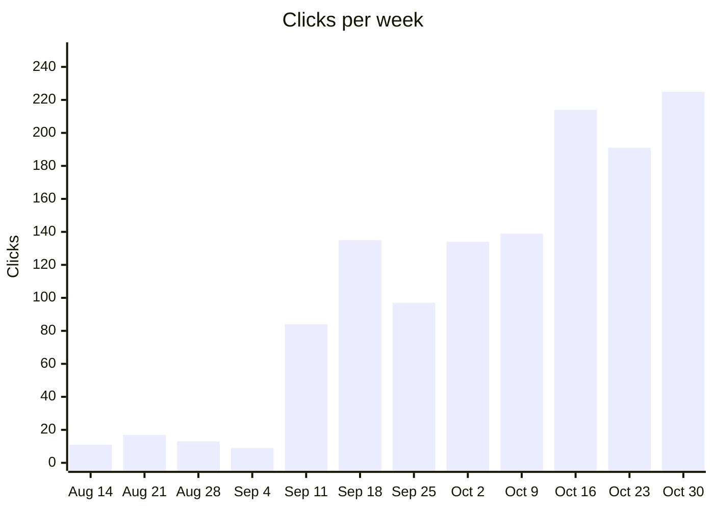

Aug 14: 11 · Aug 21: 17 · Aug 28: 13 · Sep 4: 9 · Sep 11: 84 · Sep 18: 135 · Sep 25: 97 · Oct 2: 134 · Oct 9: 139 · Oct 16: 214 · Oct 23: 191 · Oct 30: 225

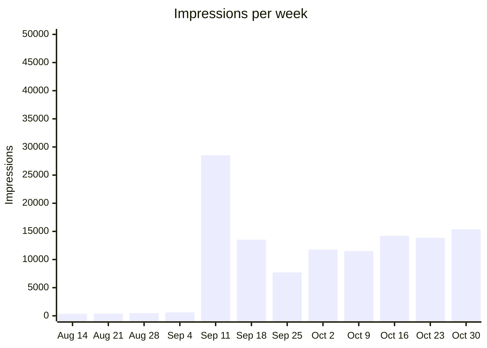

Aug 14: 368 · Aug 21: 392 · Aug 28: 474 · Sep 4: 601 · Sep 11: 28,541 · Sep 18: 13,529 · Sep 25: 7,711 · Oct 2: 11,776 · Oct 9: 11,513 · Oct 16: 14,211 · Oct 23: 13,853 · Oct 30: 15,345

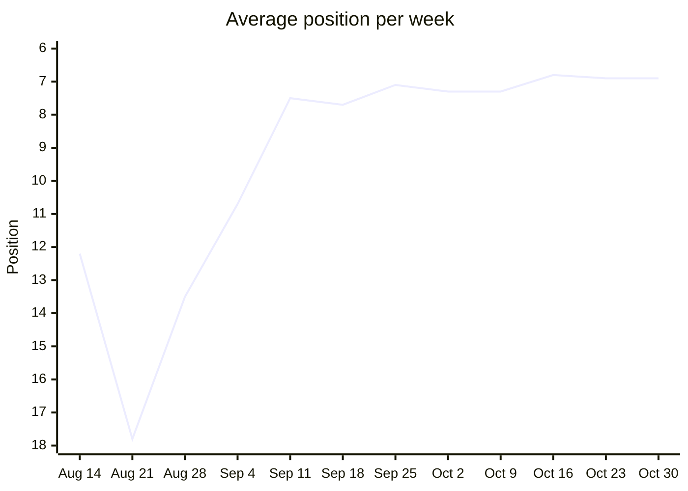

Aug 14: 12.2 · Aug 21: 17.8 · Aug 28: 13.5 · Sep 4: 10.7 · Sep 11: 7.5 · Sep 18: 7.7 · Sep 25: 7.1 · Oct 2: 7.3 · Oct 9: 7.3 · Oct 16: 6.8 · Oct 23: 6.9 · Oct 30: 6.9

Lower is better. The axis runs from the worst position at the bottom to the best at the top, so a rising line is a gain.

### Queries by position

How many queries averaged each rank that week. Search Console leaves rare queries out of query rows, so these add up to less than every search.

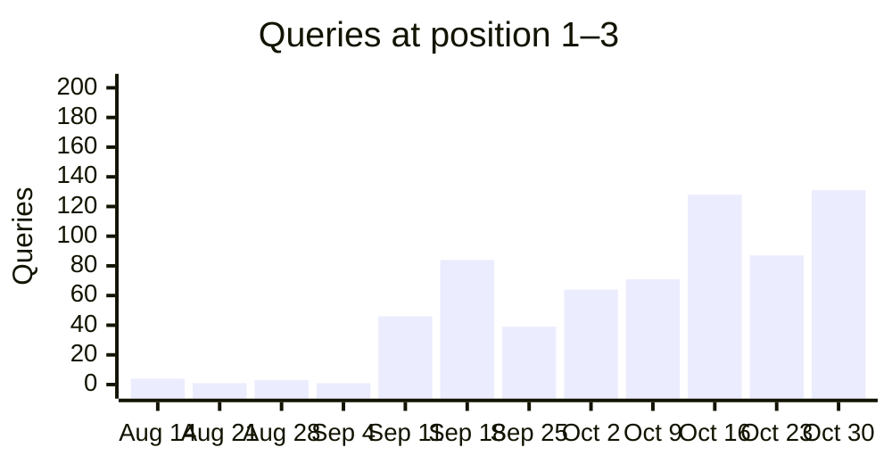

Aug 14: 4 · Aug 21: 1 · Aug 28: 3 · Sep 4: 1 · Sep 11: 46 · Sep 18: 84 · Sep 25: 39 · Oct 2: 64 · Oct 9: 71 · Oct 16: 128 · Oct 23: 87 · Oct 30: 131

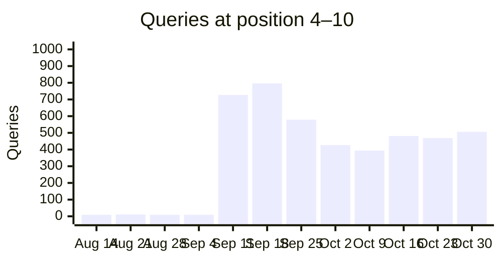

Aug 14: 9 · Aug 21: 11 · Aug 28: 9 · Sep 4: 9 · Sep 11: 727 · Sep 18: 796 · Sep 25: 579 · Oct 2: 427 · Oct 9: 394 · Oct 16: 481 · Oct 23: 469 · Oct 30: 506

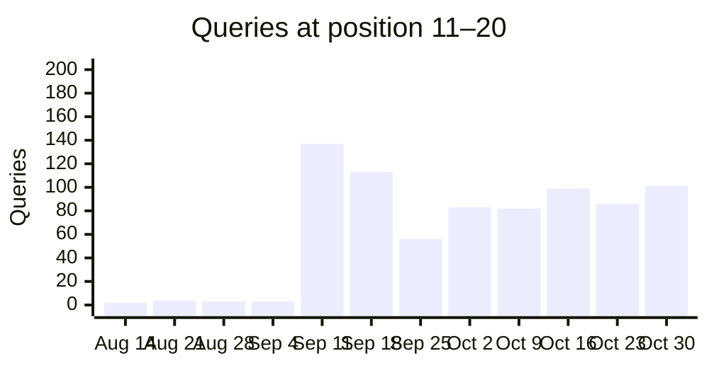

Aug 14: 2 · Aug 21: 4 · Aug 28: 3 · Sep 4: 3 · Sep 11: 137 · Sep 18: 113 · Sep 25: 56 · Oct 2: 83 · Oct 9: 82 · Oct 16: 99 · Oct 23: 86 · Oct 30: 101

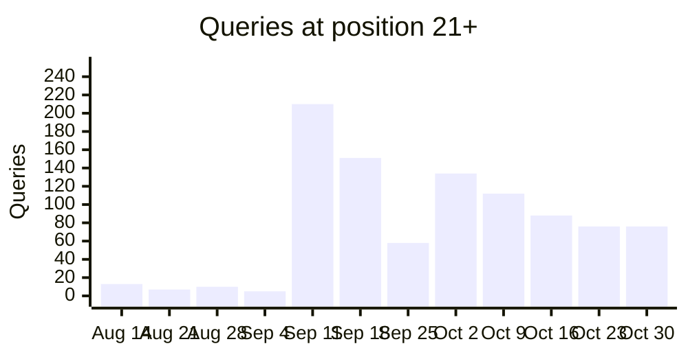

Aug 14: 13 · Aug 21: 7 · Aug 28: 10 · Sep 4: 5 · Sep 11: 210 · Sep 18: 151 · Sep 25: 58 · Oct 2: 134 · Oct 9: 112 · Oct 16: 88 · Oct 23: 76 · Oct 30: 76

### Tracked keywords over time

Average position per week for the tracked keywords seen in at least 3 weeks, the 6 with the most impressions first. Weeks the keyword was not seen are skipped, so the points are not always evenly spaced in time. 19 more have enough weeks but fewer impressions. 12 more were seen in fewer than 3 weeks.

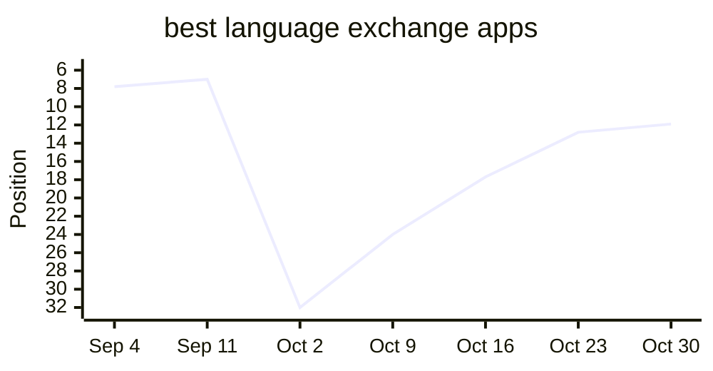

Sep 4: 7.8 · Sep 11: 7.0 · Oct 2: 32.0 · Oct 9: 24.0 · Oct 16: 17.7 · Oct 23: 12.8 · Oct 30: 11.9

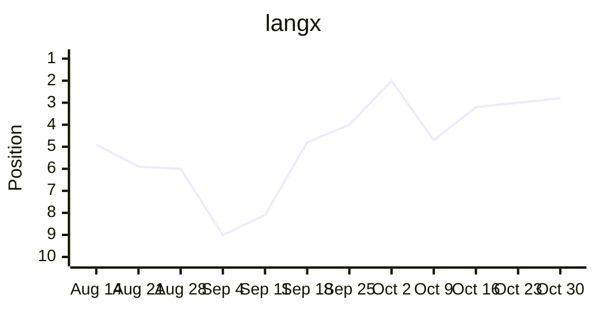

Aug 14: 4.9 · Aug 21: 5.9 · Aug 28: 6.0 · Sep 4: 9.0 · Sep 11: 8.1 · Sep 18: 4.8 · Sep 25: 4.0 · Oct 2: 2.0 · Oct 9: 4.7 · Oct 16: 3.2 · Oct 23: 3.0 · Oct 30: 2.8

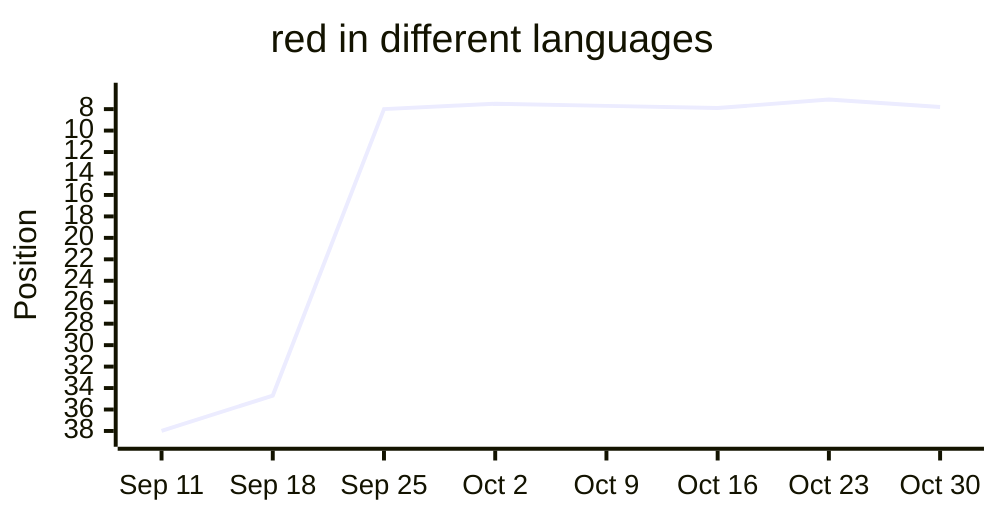

Sep 11: 38.0 · Sep 18: 34.7 · Sep 25: 8.0 · Oct 2: 7.5 · Oct 9: 7.7 · Oct 16: 7.9 · Oct 23: 7.1 · Oct 30: 7.8

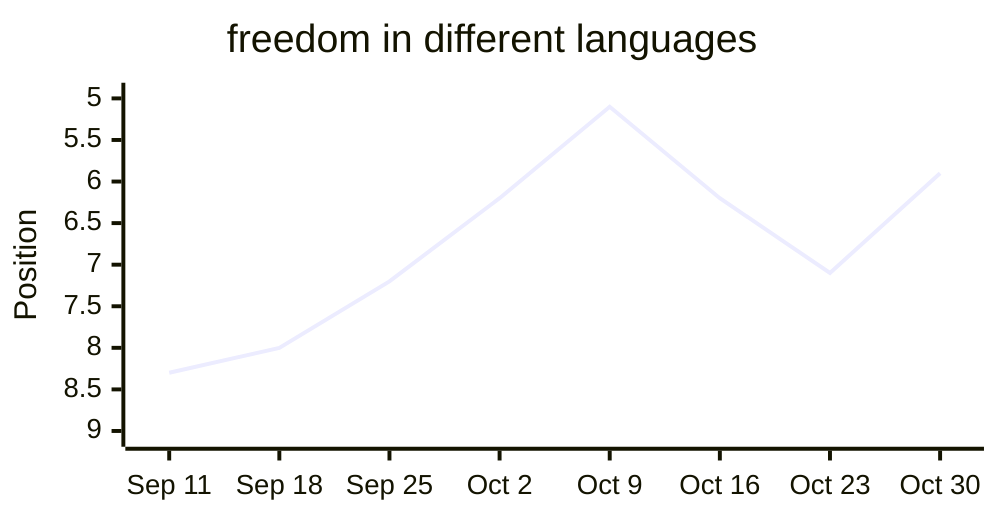

Sep 11: 8.3 · Sep 18: 8.0 · Sep 25: 7.2 · Oct 2: 6.2 · Oct 9: 5.1 · Oct 16: 6.2 · Oct 23: 7.1 · Oct 30: 5.9

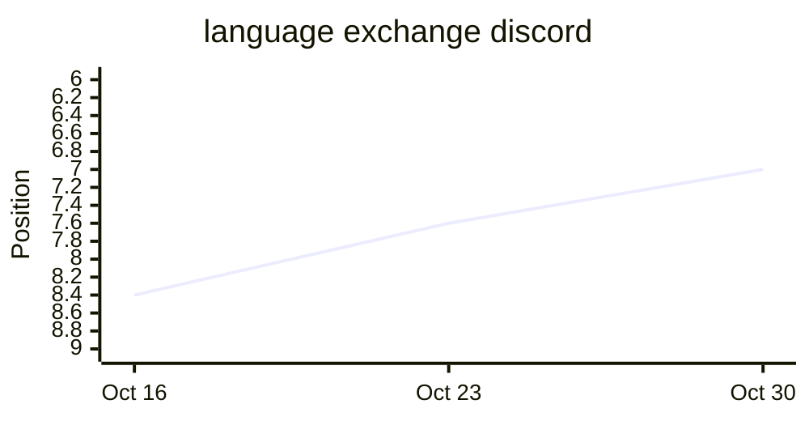

Oct 16: 8.4 · Oct 23: 7.6 · Oct 30: 7.0

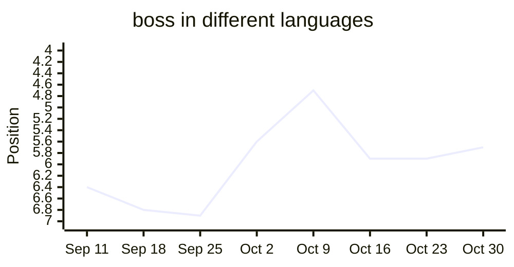

Sep 11: 6.4 · Sep 18: 6.8 · Sep 25: 6.9 · Oct 2: 5.6 · Oct 9: 4.7 · Oct 16: 5.9 · Oct 23: 5.9 · Oct 30: 5.7

## Tracked keywords

| Keyword | Position | Clicks | Impressions |
| --- | --- | --- | --- |
| langx | 2.8 (↑0.2) | 24 | 92 |
| langx app | — | 0 | 0 |
| language exchange app | 14.4 (↓4.7) | 0 | 33 |
| free language exchange app | 8.0 | 0 | 3 |
| open source language exchange app | — | 0 | 0 |
| best language exchange apps | 11.9 (↑0.9) | 0 | 85 |
| best language exchange app | 26.8 (↓3.3) | 0 | 6 |
| tandem alternative | 6.7 (↓1.1) | 0 | 3 |
| hellotalk alternative | 5.5 | 0 | 2 |
| apps like hellotalk | — (was 1.0) | 0 | 0 |
| tandem vs hellotalk | 9.3 (↑1.3) | 0 | 4 |
| hellotalk vs tandem | — (was 11.0) | 0 | 0 |
| is hellotalk free | — | 0 | 0 |
| is tandem free | — | 0 | 0 |
| language exchange partner online | — | 0 | 0 |
| how to find a language exchange partner | — | 0 | 0 |
| what is a language exchange | 7.9 (↑0.7) | 0 | 7 |
| language exchange conversation topics | — | 0 | 0 |
| duolingo alternatives for speaking | — | 0 | 0 |
| how many words do you need to be fluent | — | 0 | 0 |
| most common words in spanish | — | 0 | 0 |
| spanish vocabulary test | — | 0 | 0 |
| guess the language game | — | 0 | 0 |
| open source alternative to tandem | — | 0 | 0 |
| open source alternative to hellotalk | — | 0 | 0 |
| langx vs tandem | — | 0 | 0 |
| langx vs hellotalk | — | 0 | 0 |
| social alternative to duolingo | — | 0 | 0 |
| duolingo with real people | — | 0 | 0 |
| social language learning apps | — | 0 | 0 |
| best language learning apps | 78.5 (↓18.5) | 0 | 4 |
| free language learning apps | 10.7 (↓0.3) | 0 | 9 |
| free language exchange apps | 11.3 (↓4.6) | 0 | 3 |
| can you become fluent with duolingo | — | 0 | 0 |
| best language exchange apps 2026 | 19.0 (↑2.5) | 0 | 1 |
| best language exchange apps for beginners | 1.0 (↑8.0) | 0 | 1 |
| language exchange apps | 16.6 (↓1.7) | 0 | 39 |
| how long does it take to learn a language | — | 0 | 0 |
| easiest languages to learn for english speakers | — | 0 | 0 |
| shadowing technique | — | 0 | 0 |
| comprehensible input | — | 0 | 0 |
| spaced repetition language learning | — | 0 | 0 |
| best pen pal apps | — | 0 | 0 |
| language exchange discord | 7.0 (↑0.6) | 0 | 188 |
| language exchange meetup | — | 0 | 0 |
| is hellotalk safe | — | 0 | 0 |
| is tandem safe | 4.5 (↑1.5) | 1 | 14 |
| malayalam alphabet | — | 0 | 0 |
| most common tagalog words | — | 0 | 0 |
| most common afrikaans words | — | 0 | 0 |
| princess in different languages | — | 0 | 0 |
| freedom in different languages | 5.9 (↑1.2) | 0 | 48 |
| soul in different languages | — | 0 | 0 |
| aunt in different languages | — (was 7.0) | 0 | 0 |
| boss in different languages | 5.7 (↑0.1) | 0 | 15 |
| red in different languages | 7.8 (↓0.7) | 0 | 90 |
| black in different languages | — | 0 | 0 |
| alone in other languages | 5.0 (↑0.3) | 0 | 4 |
| sword in different languages | 6.3 (↑0.2) | 0 | 19 |
| german speaking practice app | — | 0 | 0 |
| german conversation app | — | 0 | 0 |
| chinese conversation app | — | 0 | 0 |
| apps to practice speaking french | — | 0 | 0 |

## Top queries

| Query | Position | Clicks | Impressions | CTR |
| --- | --- | --- | --- | --- |
| langx | 2.8 (↑0.2) | 24 | 92 | 26.1% |
| sun in different languages | 5.5 (↑1.2) | 4 | 173 | 2.3% |
| lang x | 1.9 (↑0.4) | 3 | 11 | 27.3% |
| duolingo open source alternative | 4.1 (↓0.3) | 3 | 9 | 33.3% |
| night in different languages | 4.6 (↑1.0) | 2 | 54 | 3.7% |
| duolingo open source | 7.1 (↓0.3) | 2 | 25 | 8.0% |
| sites like interpals | 1.0 (↑6.0) | 2 | 2 | 100.0% |
| freedom in other languages | 6.7 (=) | 1 | 52 | 1.9% |
| langx サインイン | 5.0 (↑0.4) | 1 | 43 | 2.3% |
| beauty in different languages | 5.7 (↑0.5) | 1 | 34 | 2.9% |
| armenian alphabet letters | 9.1 (↓0.1) | 1 | 27 | 3.7% |
| open source duolingo | 5.6 (↓0.6) | 1 | 26 | 3.8% |
| is tandem safe | 4.5 (↑1.5) | 1 | 14 | 7.1% |
| open source duolingo alternative | 2.6 (↑0.7) | 1 | 13 | 7.7% |
| whore in different languages | 2.1 (↓0.3) | 1 | 8 | 12.5% |
| red in other languages list | 6.6 (↑0.1) | 1 | 7 | 14.3% |
| duolingo opensource | 7.5 (↓1.8) | 1 | 6 | 16.7% |
| excellent in different languages | 5.2 (↑0.3) | 1 | 6 | 16.7% |
| the color red in different languages | 6.5 | 1 | 4 | 25.0% |
| words for sun in different languages | 6.5 (↑3.5) | 1 | 4 | 25.0% |
| 10000 most common french words | 2.0 | 1 | 2 | 50.0% |
| free language learning apps without subscription | 7.5 (↓6.5) | 1 | 2 | 50.0% |
| 10,000 most common chinese words | 1.0 (↑1.0) | 1 | 1 | 100.0% |
| praktika free alternative | 6.0 | 1 | 1 | 100.0% |
| website | 4.0 | 1 | 1 | 100.0% |

## Moved up

| Query | Position | Impressions |
| --- | --- | --- |
| sun in different languages | 6.7 → 5.5 | 173 |
| freedom in different languages | 7.1 → 5.9 | 48 |
| night in other languages | 5.4 → 4.3 | 49 |
| free in different languages | 5.9 → 4.9 | 23 |

## Moved down

| Query | Position | Impressions |
| --- | --- | --- |
| milk in other languages | 7.4 → 10.2 | 24 |
| cheap language app near austin | 4.7 → 7.2 | 29 |
| language exchange | 4.5 → 6.5 | 289 |
| language exchange apps | 14.9 → 16.6 | 39 |
| milk in different languages | 8.7 → 10.1 | 20 |

## Close to page one

| Query | Position | Impressions | Clicks |
| --- | --- | --- | --- |
| armenian alphabet | 9.4 | 236 | 0 |
| is language app worth it 2026 | 9.7 | 228 | 0 |
| best language exchange apps | 11.9 | 85 | 0 |
| language exchange apps | 16.6 | 39 | 0 |
| language exchange app | 14.4 | 33 | 0 |
| armenian alphabet letters | 9.1 | 27 | 1 |
| milk in other languages | 10.2 | 24 | 0 |
| how to say bomb in arabic | 9.3 | 22 | 0 |
| milk in different languages | 10.1 | 20 | 0 |

## New this week

| Query | Position | Impressions |
| --- | --- | --- |
| best cheap language app under 500 | 7.1 | 65 |
| ogima - social language learning alternatives | 1.7 | 32 |

## Top pages

| Page | Position | Clicks | Impressions | CTR |
| --- | --- | --- | --- | --- |
| / | 4.5 (↑0.1) | 45 | 356 | 12.6% |
| /language-exchange-conversation-topics | 5.3 (↑2.1) | 17 | 334 | 5.1% |
| /open-source-alternative-to-duolingo | 4.9 (=) | 13 | 316 | 4.1% |
| /tools/most-common-words/french | 5.7 (↑4.7) | 9 | 67 | 13.4% |
| /tools/say/sun | 6.7 (↑0.1) | 7 | 695 | 1.0% |
| /free-language-learning-apps | 8.6 (↓1.9) | 7 | 422 | 1.7% |
| /best-language-exchange-apps | 5.3 (↑1.4) | 6 | 535 | 1.1% |
| /is-tandem-safe | 5.3 (↑0.7) | 6 | 405 | 1.5% |
| /best-apps-to-practice-japanese-with-native-speakers | 9.0 (↓1.1) | 5 | 183 | 2.7% |
| /tools/vocabulary-test | 27.1 (↓7.8) | 4 | 13 | 30.8% |
| /tools/say/red | 7.1 (↓0.1) | 3 | 381 | 0.8% |
| /free-language-exchange-apps | 5.9 (↓0.1) | 3 | 123 | 2.4% |
| /tools/vocabulary-test/turkish | 6.5 (↓0.2) | 3 | 26 | 11.5% |
| /tools/most-common-words/chinese | 2.1 (↑9.0) | 3 | 20 | 15.0% |
| /tools/most-common-words/turkish | 5.8 (↑4.0) | 3 | 16 | 18.8% |
| /tools/most-common-words/urdu | 14.0 (↓10.3) | 3 | 5 | 60.0% |
| /language-exchange-discord-servers | 7.3 (↑0.3) | 2 | 363 | 0.6% |
| /tools/say/night | 4.7 (↑1.1) | 2 | 267 | 0.7% |
| /social-language-learning-apps | 5.9 (↑1.1) | 2 | 195 | 1.0% |
| /armenian-alphabet-guide | 8.2 (↑0.1) | 2 | 150 | 1.3% |
| /tandem-vs-hellotalk | 6.4 (↓0.4) | 2 | 145 | 1.4% |
| /tools/say/whore | 6.4 (↓0.8) | 2 | 103 | 1.9% |
| /best-pen-pal-apps-for-language-learning | 6.6 (↑0.7) | 2 | 87 | 2.3% |
| /tools/similar/persian-and-urdu | 7.3 (=) | 2 | 65 | 3.1% |
| /tools/most-common-words/armenian | 7.1 (↑1.3) | 2 | 44 | 4.5% |

