[](https://status.langx.io)

# [langx.io](https://langx.io)

Welcome to LangX! LangX matches you with people who speak the language you're learning and are learning the language you speak — real conversations, message corrections and built-in translation, on iOS, Android and the web.

This repository is the site at [langx.io](https://langx.io): the product pages, the
[blog](https://langx.io/blog), and a set of free [language tools](https://langx.io/tools) —
the most common words in 53 languages, "say it in any language", word games, a
vocabulary test and more, with the words read aloud by the same voices the app
uses (see [`scripts/wordlists/`](scripts/wordlists)).

## Keeping the numbers honest

Several pages state limits and prices that are enforced by the app, not by this
site. They are mirrored in [`src/lib/data/plans.ts`](src/lib/data/plans.ts) and
[`src/lib/data/token.ts`](src/lib/data/token.ts), each of which points at the
file in `langx` it copies:

| Here                       | Source of truth in `langx`                                                   |
| -------------------------- | ---------------------------------------------------------------------------- |
| `src/lib/data/plans.ts`    | `packages/shared/src/limits.ts` (`PLAN_LIMITS`)                              |
| `src/lib/data/features.ts` | `packages/shared/src/limits.ts` — which plan unlocks each feature            |
| `src/lib/data/token.ts`    | `packages/shared/src/token.ts` (`TOKEN_RULES`), `cosmetics.ts` (`COSMETICS`) |

There are two plans — Free and Pro. Pro is the one paid plan. Anything here that describes a paid feature has to name the plan
that actually unlocks it.

When a limit or a token rule changes in `langx`, change it in the matching file
here. Nothing checks this automatically, so a claim on the site can drift into
being false without anything failing — which is exactly what this section exists
to prevent.

The [community guidelines](https://langx.io/community-guidelines) are a
hand-kept, word-for-word copy too: `src/lib/components/organisms/CommunityGuidelines.md`
copies `docs/community-guidelines.md` in `langx`, which owns the text. When that
file changes, make the same change here.

The product claims on this site are also constrained by
`langx/docs/legal/promise-change.md` and `langx/docs/token-messaging-brief.md`.
Before adding a feature claim, check it is one the shipping app actually meets.

## Table of Contents

- [Keeping the numbers honest](#keeping-the-numbers-honest)
- [Getting started](#getting-started)
- [Building](#building)
- [Contributing](#contributing)
- [Screenshots](#screenshots)
- [Versioning](#versioning)
- [Stats](#stats)
- [License](#license)

## Getting started

To clone this project, simply run the following command:

```bash
# clone this repo
git clone  https://github.com/langx/website

# install dependencies
npm install
```

Once you've created your project and installed dependencies with `npm install`, you can start a development server:

```bash
npm run dev

# or start the server and open the app in a new browser tab
npm run dev -- --open
```

## Building

To create a production version of your app:

```bash
npm run build
```

You can preview the production build with `npm run preview`.

## Contributing

LangX is open source and we welcome contributions from the community. Fork the
repository, make your change, and open a pull request — before you do, run:

```bash
npm run lint
npm run format
```

We'll review your changes and merge them if they meet our guidelines. Thank you for helping to make LangX even better!

## Screenshots

What langx.io looks like, kept here so the redesigns can be compared side by side.
Each shot follows your GitHub theme; the [`docs/screenshots`](docs/screenshots) folders have both the light
and the dark version of every one.

### Before the v3 redesign (October 2026)

Captured from the live site on 20 October 2026, at 1440×900 on desktop and
390×844 on a phone, signed out.

<table>
<tr><th>Page</th><th>Desktop</th><th>Phone</th></tr>
<tr>
<td><a href="https://langx.io">Home</a></td>
<td><picture><source media="(prefers-color-scheme: dark)" srcset="docs/screenshots/before-v3/home-desktop-dark.webp">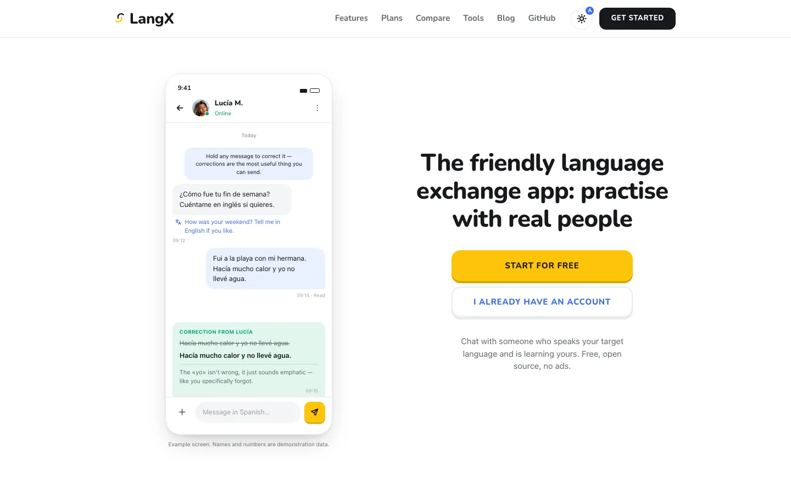</picture></td>
<td><picture><source media="(prefers-color-scheme: dark)" srcset="docs/screenshots/before-v3/home-mobile-dark.webp"></picture></td>
</tr>
<tr>
<td><a href="https://langx.io/plans">Plans</a></td>
<td><picture><source media="(prefers-color-scheme: dark)" srcset="docs/screenshots/before-v3/plans-desktop-dark.webp">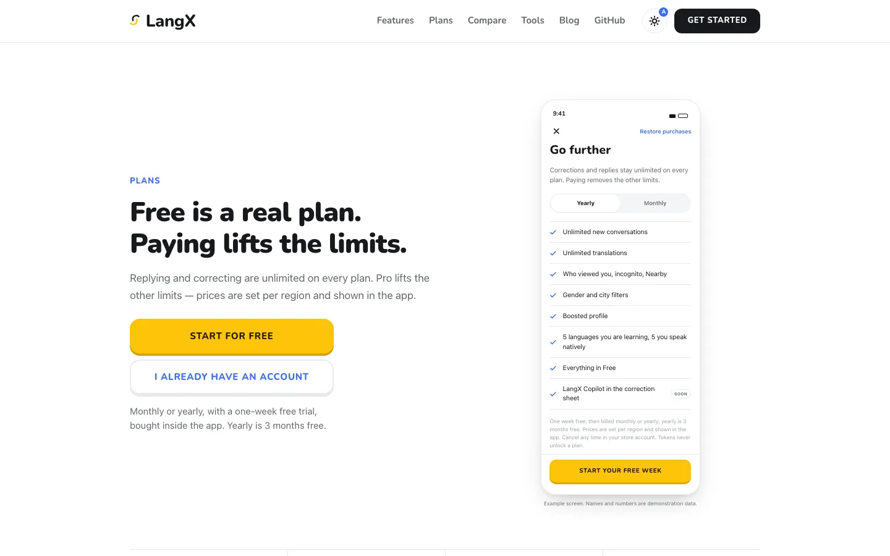</picture></td>
<td><picture><source media="(prefers-color-scheme: dark)" srcset="docs/screenshots/before-v3/plans-mobile-dark.webp">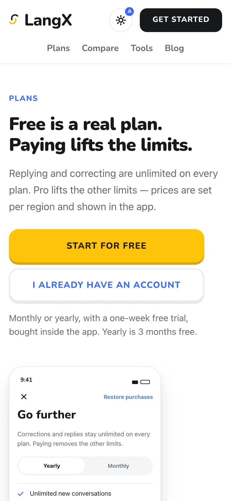</picture></td>
</tr>
<tr>
<td><a href="https://langx.io/blog">Blog</a></td>
<td><picture><source media="(prefers-color-scheme: dark)" srcset="docs/screenshots/before-v3/blog-desktop-dark.webp">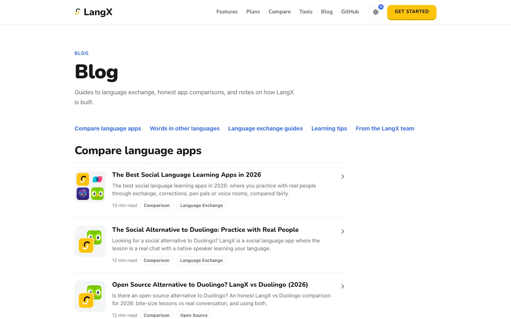</picture></td>
<td><picture><source media="(prefers-color-scheme: dark)" srcset="docs/screenshots/before-v3/blog-mobile-dark.webp">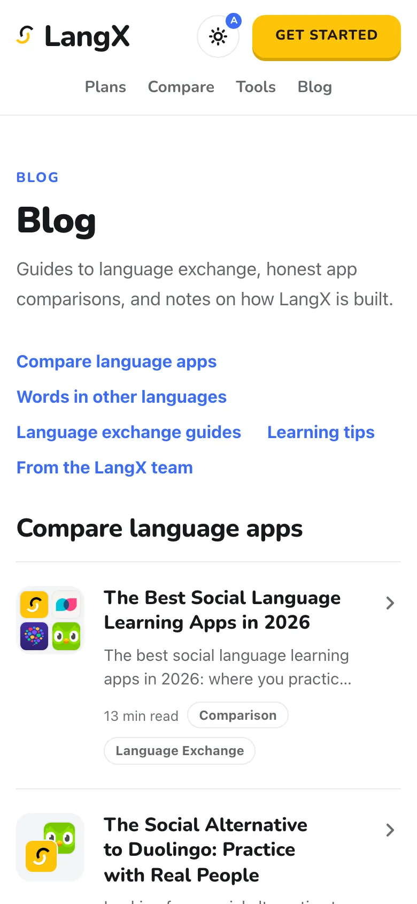</picture></td>
</tr>
<tr>
<td><a href="https://langx.io/tools">Tools</a></td>
<td><picture><source media="(prefers-color-scheme: dark)" srcset="docs/screenshots/before-v3/tools-desktop-dark.webp">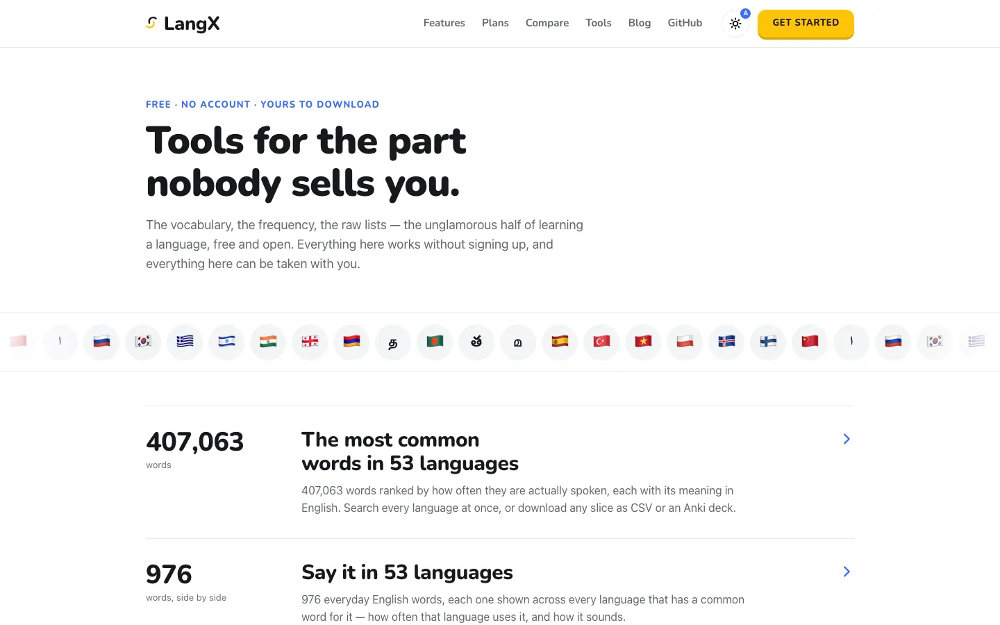</picture></td>
<td><picture><source media="(prefers-color-scheme: dark)" srcset="docs/screenshots/before-v3/tools-mobile-dark.webp">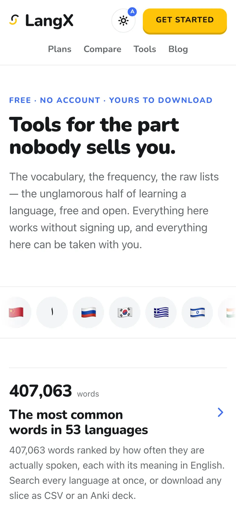</picture></td>
</tr>
</table>

<details>
<summary>The whole homepage, top to bottom</summary>

Desktop (<a href="docs/screenshots/before-v3/home-desktop-light-full.webp">light</a> · <a href="docs/screenshots/before-v3/home-desktop-dark-full.webp">dark</a>):

<picture><source media="(prefers-color-scheme: dark)" srcset="docs/screenshots/before-v3/home-desktop-dark-full.webp"></picture>

Phone (<a href="docs/screenshots/before-v3/home-mobile-light-full.webp">light</a> · <a href="docs/screenshots/before-v3/home-mobile-dark-full.webp">dark</a>):

<picture><source media="(prefers-color-scheme: dark)" srcset="docs/screenshots/before-v3/home-mobile-dark-full.webp"></picture>

</details>

### After the v3 redesign (October 2026)

Captured from the live site on 21 October 2026, the same way as the shots
above. The redesign added two pages, FAQ and Download.

<table>
<tr><th>Page</th><th>Desktop</th><th>Phone</th></tr>
<tr>
<td><a href="https://langx.io">Home</a></td>
<td><picture><source media="(prefers-color-scheme: dark)" srcset="docs/screenshots/after-v3/home-desktop-dark.webp">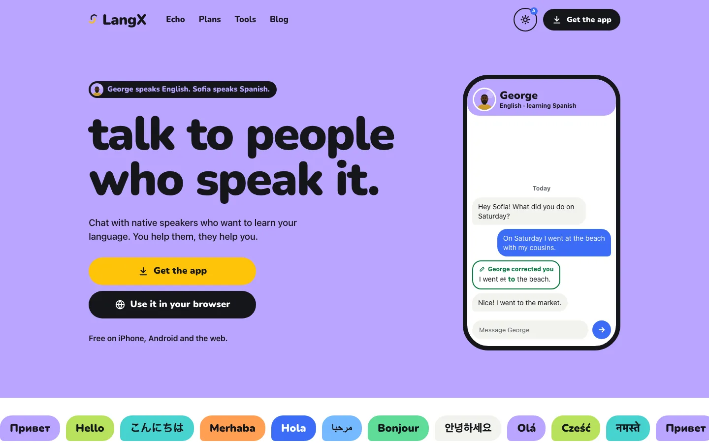</picture></td>
<td><picture><source media="(prefers-color-scheme: dark)" srcset="docs/screenshots/after-v3/home-mobile-dark.webp">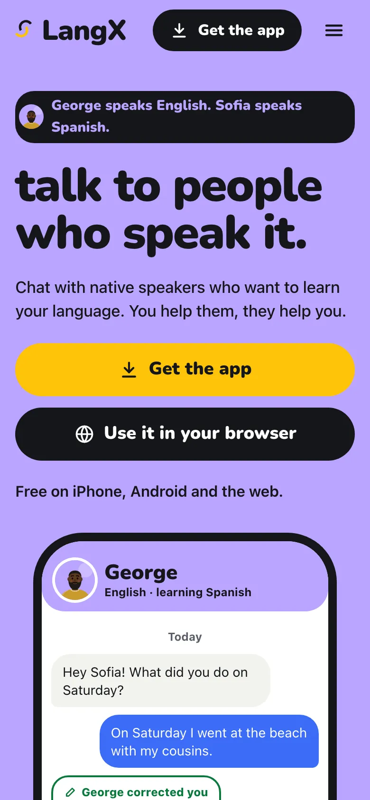</picture></td>
</tr>
<tr>
<td><a href="https://langx.io/plans">Plans</a></td>
<td><picture><source media="(prefers-color-scheme: dark)" srcset="docs/screenshots/after-v3/plans-desktop-dark.webp">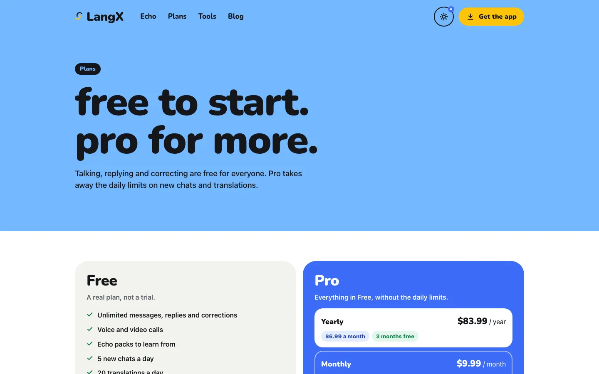</picture></td>
<td><picture><source media="(prefers-color-scheme: dark)" srcset="docs/screenshots/after-v3/plans-mobile-dark.webp">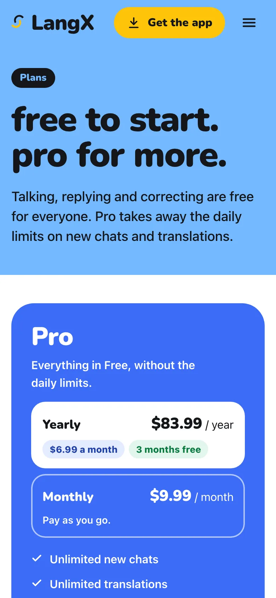</picture></td>
</tr>
<tr>
<td><a href="https://langx.io/blog">Blog</a></td>
<td><picture><source media="(prefers-color-scheme: dark)" srcset="docs/screenshots/after-v3/blog-desktop-dark.webp">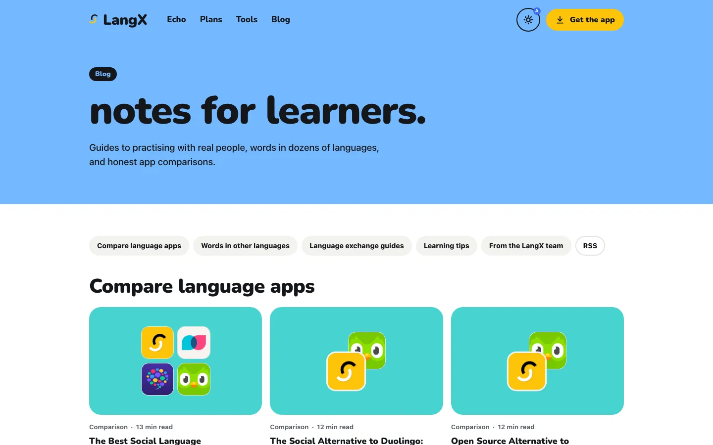</picture></td>
<td><picture><source media="(prefers-color-scheme: dark)" srcset="docs/screenshots/after-v3/blog-mobile-dark.webp">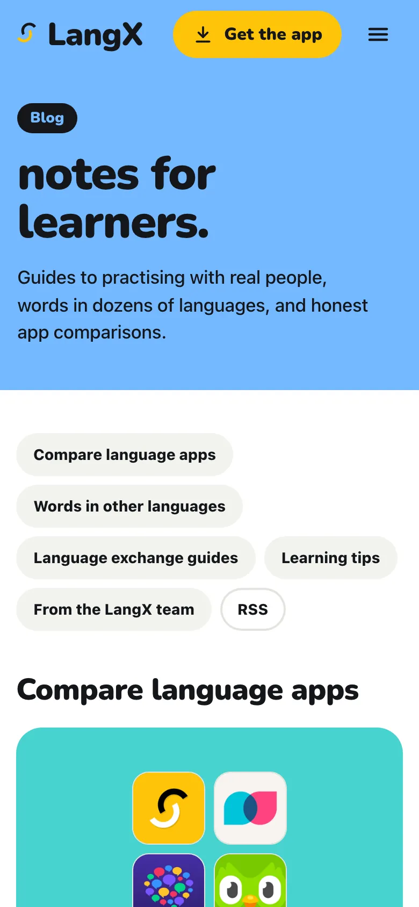</picture></td>
</tr>
<tr>
<td><a href="https://langx.io/tools">Tools</a></td>
<td><picture><source media="(prefers-color-scheme: dark)" srcset="docs/screenshots/after-v3/tools-desktop-dark.webp">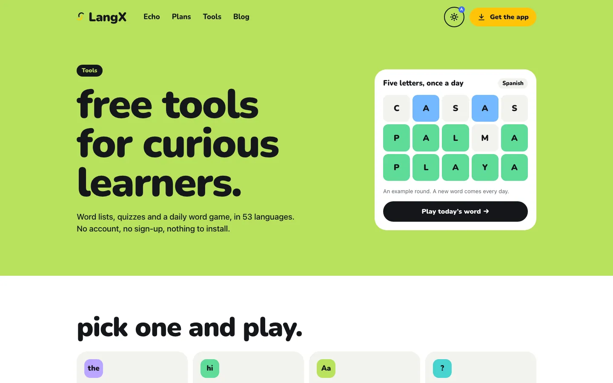</picture></td>
<td><picture><source media="(prefers-color-scheme: dark)" srcset="docs/screenshots/after-v3/tools-mobile-dark.webp">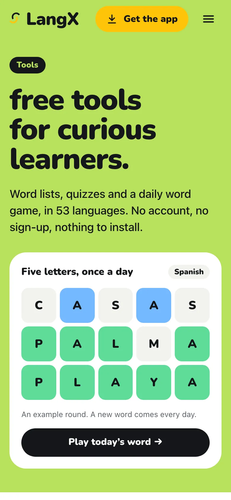</picture></td>
</tr>
<tr>
<td><a href="https://langx.io/faq">FAQ</a></td>
<td><picture><source media="(prefers-color-scheme: dark)" srcset="docs/screenshots/after-v3/faq-desktop-dark.webp">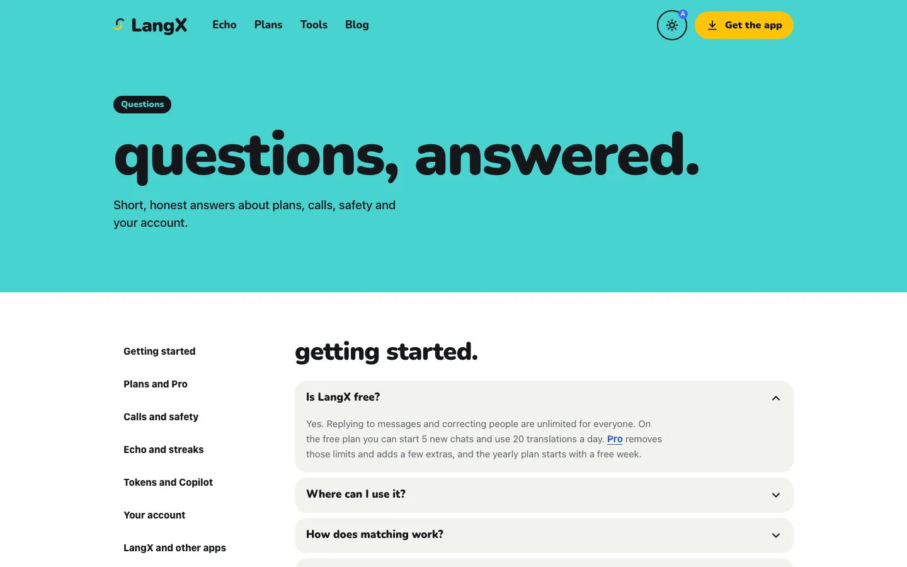</picture></td>
<td><picture><source media="(prefers-color-scheme: dark)" srcset="docs/screenshots/after-v3/faq-mobile-dark.webp">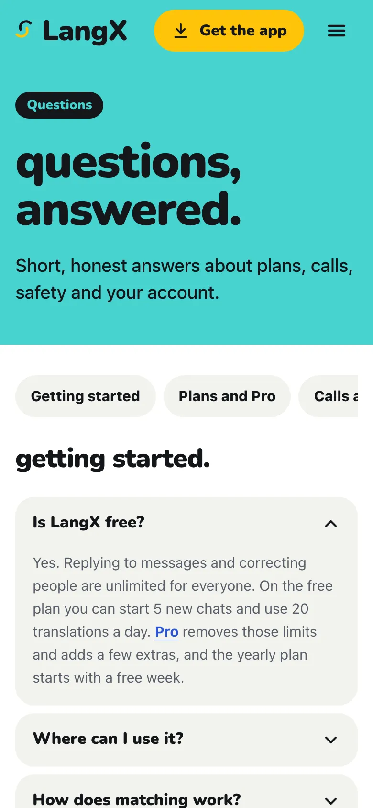</picture></td>
</tr>
<tr>
<td><a href="https://langx.io/download">Download</a></td>
<td><picture><source media="(prefers-color-scheme: dark)" srcset="docs/screenshots/after-v3/download-desktop-dark.webp">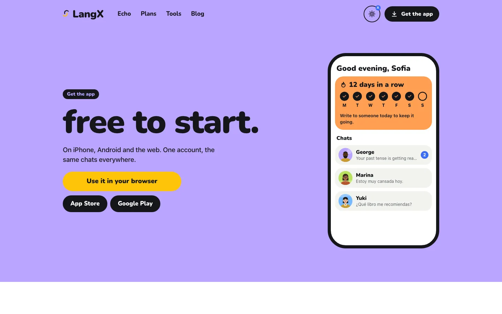</picture></td>
<td><picture><source media="(prefers-color-scheme: dark)" srcset="docs/screenshots/after-v3/download-mobile-dark.webp">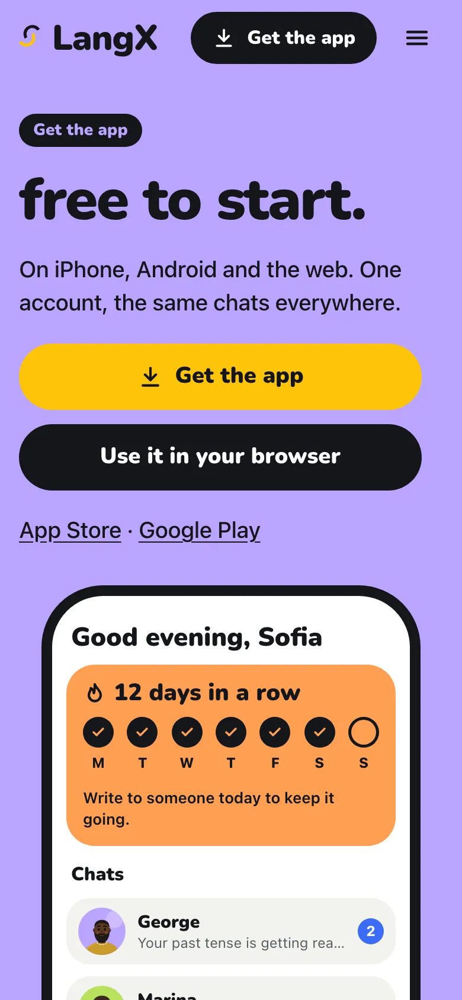</picture></td>
</tr>
</table>

<details>
<summary>The whole homepage, top to bottom</summary>

Desktop (<a href="docs/screenshots/after-v3/home-desktop-light-full.webp">light</a> · <a href="docs/screenshots/after-v3/home-desktop-dark-full.webp">dark</a>):

<picture><source media="(prefers-color-scheme: dark)" srcset="docs/screenshots/after-v3/home-desktop-dark-full.webp">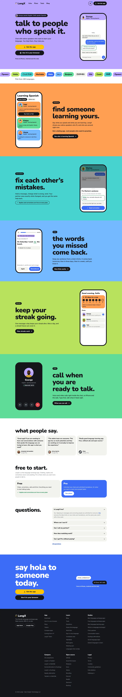</picture>

Phone (<a href="docs/screenshots/after-v3/home-mobile-light-full.webp">light</a> · <a href="docs/screenshots/after-v3/home-mobile-dark-full.webp">dark</a>):

<picture><source media="(prefers-color-scheme: dark)" srcset="docs/screenshots/after-v3/home-mobile-dark-full.webp">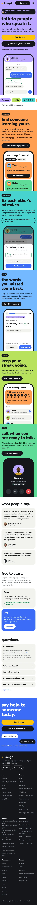</picture>

</details>

## Versioning

LangX uses [Semantic Versioning](https://semver.org/) for versioning. For the versions available, see the [tags on this repository](https://github.com/langx/website/releases).

### [v2](https://github.com/langx/website/releases/tag/v2.0.0)

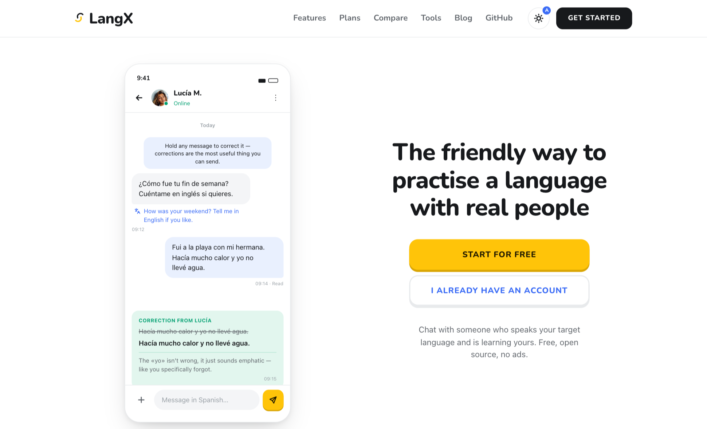

### [v0.2](https://github.com/langx/website/releases/tag/v0.2)

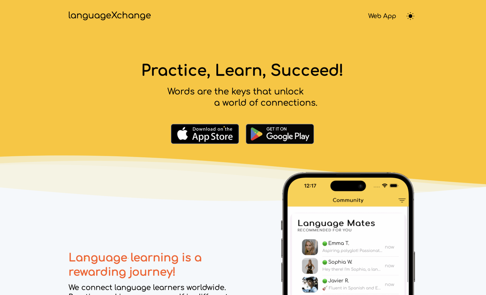

### [v0.1](https://github.com/langx/website/releases/tag/v0.1)

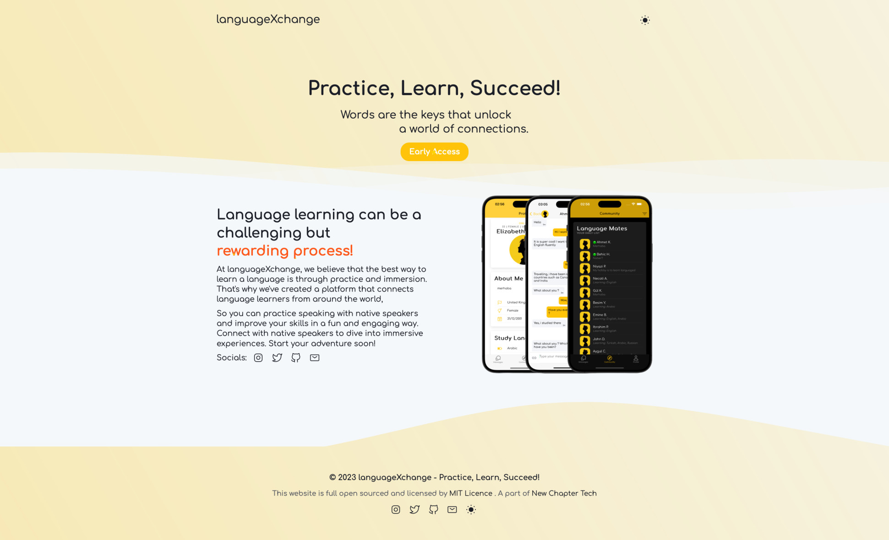

## Stats

### Stargazers

[](https://starchart.cc/langx/website)

### Contributors

[](https://git-contributor.com?chart=contributorOverTime&repo=langx/website)

[](https://github.com/langx/website/graphs/contributors)

## License

LangX is released under the [MIT License](./LICENSE). If you use this project, please include the license file in your distribution.
